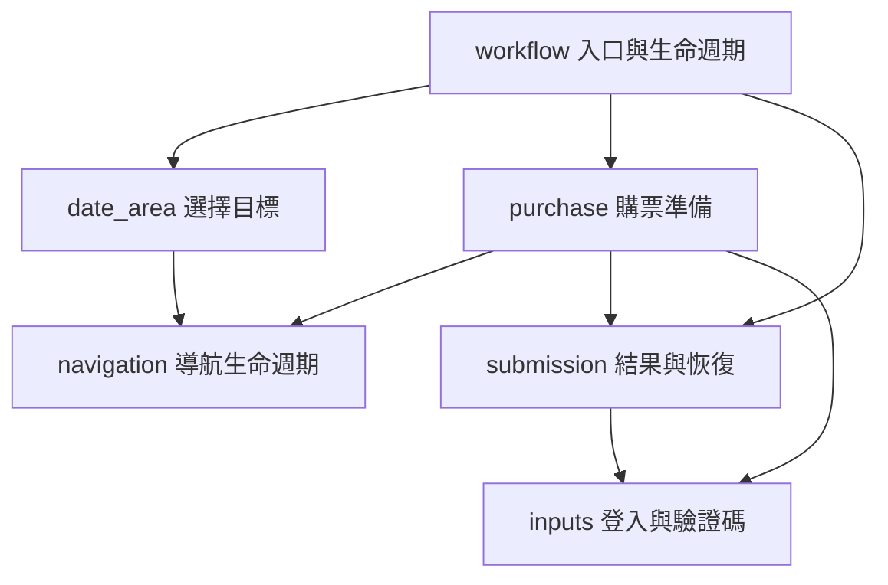

# uTiki 架構重做計畫

## 決策與範圍

以 `944e934546f3dd36b1b4891a5a4fa359b8ade17f` 的實際行為作為基準，重新整理 uTiki 家族的責任、狀態存取與呼叫關係。架構改善的交付條件是：**原本能完成的操作繼續能完成，原本可人工介入後接手的情況繼續可接手，程式更容易定位、理解與修改。**

日期、區域、票種、張數、座位、登入、驗證碼、錯誤恢復、暫停、設定更新、刷新、通知及舊設定相容，都屬於保留範圍。使用者已允許大幅調整內部架構；這不包含新增指定 Cookie/session 資格、設定版本相等、來源導航證明或其他原本沒有的操作門檻。

**本次僅重整架構並等價重現 `944e934` 的既有功能，不擴充功能範圍。** 原本未支援的功能不列為本次待補項目、後續實作批次或完成條件；重構結束後，如有新增需求，再另行討論。

等價保留也包含原有能力邊界。下文的摘要不能被解讀成比 `944e934` 更強的功能保證；若摘要過廣，應依原分支修正描述，不為兌現文字而補做功能。無法確定原行為，或確實需要改變使用行為時，先提出具體差異詢問使用者，未釐清前不把新行為納入實作或驗收。

本計畫採用 `944e934` 的來源碼重新分工。`a47fd07` 僅提供可獨立採用的設計經驗；`facebook_monitor_py` 僅提供職責劃分與生命週期管理的參考。

**交付狀態：架構方案與實作驗收規格，尚未實作或推送新版本。** Repository 的 [AGENTS.md 第 2 節][agents] 要求大規模架構重寫先有維護者同意的正式計畫；此文件讓修改範圍、行為保留及驗證方式能在動工前被具體審閱。

### 固定參考版本

| 用途 | Repository 與 commit |
| --- | --- |
| 唯一行為基準 | `OooPeople/tickets_hunter@944e934546f3dd36b1b4891a5a4fa359b8ade17f` |
| 前次重構參考 | `OooPeople/tickets_hunter@a47fd07106eae598c8b44972282c6621bf7f493c` |
| Facebook 架構參考 | `OooPeople/facebook_monitor_py@7f3af935d2a624ad49b59514231d41c701028a3e` |

2026-10-23 查核時，Tickets Hunter 的 `main` 指向 `944e934`；`codex/utiki-refactor-clean-history` 指向 `a47fd07`。正式來源應固定到完整 commit，避免後續分支移動使基準改變。

## 既有架構與真正需要改善的地方

### 保留已成立的設計

`944e934` 已經完成有價值的整理：

- `selection.py` 以純函式從快照產生日期、區域、座位及票數計畫。
- `dom.py` 負責讀快照、套用選擇與提交；呼叫完成和狀態確認有區別。
- 每個分頁只有一份 runtime，包含 document、transition、purchase 與 refresh 等狀態。
- 提交以原有購票識別、nonce、document 及結果紀錄處理重入與延遲回覆。
- 刷新已整合本地等待與共用協調器，並處理暫停、預約、送出及等待新 document。

因此這次有充足理由保留快照、計畫、原子 DOM 操作與既有刷新協調的核心。架構重做應集中在工作流責任與資料依賴，而不是再定義一套購票資格模型。來源：[workflow][workflow]、[selection][selection]、[DOM][dom]、[refresh][refresh]。

### 具體結構問題

| 現況 | 維護上的影響 | 本次處理 |
| --- | --- | --- |
| `workflow.py` 同時管理 runtime、導航、登入、OCR、購票準備、提交結果、恢復及通知 | 修一個流程時，要理解大量無關的跨階段狀態 | 按真實操作與狀態生命週期分工 |
| 導航準備在前半部，抵達及返回來源在後半部 | 追蹤一次日期／區域導航，要跨過整段提交恢復程式 | 把選擇目標與導航生命週期各自集中 |
| 函式反覆從全域 runtime 取得局部資料 | 參數看不出依賴哪些狀態，測試容易依賴私有全域 | 明確傳入同一份 runtime 或所需子狀態 |
| `refresh.py` 同時處理 document 觀察、429、probe 與 reload request | 改 document 分類時容易碰到刷新租約生命週期 | 分離觀察與既有 429 管理，保持 request 生命週期完整 |
| 字典的 kind、phase、optional 欄位不夠明確 | 欄位意義及允許缺少資料的情況不容易看懂 | 為既有資料補型別，保留原有接受條件與物件身分 |

### 程式規模的基線

下表只計算 `src/platforms/utiki/` 內 Python 與 JavaScript 的實體行數，包含空白、註解與 docstring，不含測試、文件或 JSON。數值由固定版本完整檔案重新計算。

| 版本 | Python 檔案與行數 | JavaScript 檔案與行數 | 合計 |
| --- | --- | --- | --- |
| `944e934` | 7 檔，9,718 行 | 0 檔 | 9,718 行 |
| `a47fd07` | 26 檔，10,686 行 | 24 檔，2,497 行 | 13,183 行 |

前次增加 3,465 行，約 35.7%。`944e934` 的 workflow 為 3,547 行；前次重構的 engine 為 3,972 行。這些數字不能直接證明速度或品質，但足以要求新抽象說清楚實際用途。[版本差異][compare]

本次不訂「每檔必須少於幾行」這類會製造轉送層的配額。完成時應同時報告 production 總量、移動與新增的內容、公開入口到實際操作的呼叫路徑，以及每一個新增模組的具體責任。為等價整理增加大量條件與樣板程式，應回頭簡化設計。

## 目標架構

### 模組分工

使用普通 Python 函式模組即可。只有確實需要持有資源或封裝既有狀態的地方才使用 class；不預先建立每個模組的 interface、factory、adapter 與 service 四層。

| 模組 | 核心責任 | 狀態與邊界 |
| --- | --- | --- |
| `workflow.py` | 既有公開入口、分頁狀態 registry、生命週期、原順序的前置處理與頁型分派 | 唯一持有正式 registry 與 cancel-task 集合；薄流程協調 |
| `runtime.py` | 既有 record 的型別、constructor 與不持有全域狀態的 helper | 不建立第二個 registry、不作購票資格判斷 |
| `date_area.py` | 日期／區域快照、候選選擇、fast 預取後的候選選擇、無候選時既有刷新與 fallback | 決定目標；只持有短期 snapshot／plan |
| `navigation.py` | 已選目標的導航送出、pending、未知結果、目的地核對、marker 清理及返回原生頁 | 唯一修改既有 pending 與電腦配位來源紀錄 |
| `purchase.py` | 手動劃位頁、一般票數頁、電腦配位票數頁的準備流程；串接登入、驗證碼與提交 | 使用目前設定及既有 selection／DOM 操作 |
| `inputs.py` | Cookie 注入、inline login、登入 fingerprint、captcha 取圖、辨識、填寫及相關 DOM 操作 | 不擁有 outcomes、不自行提交、不建立 session authority |
| `submission.py` | 提交、結果歸屬、對話框處理、CAPTCHA／座位衝突恢復、未知結果保留及 checkout 通知 | 唯一修改 active submit、outcomes、last submit 與通知去重 |
| `refresh.py` | 同一 reload request 的建立、預約、送出、等待、完成、暫停及取消 | 保持完整 request 生命週期及共用協調器接線 |
| `document_health.py` | 既有 document 快照、快取、canonical token 與正常／未知／429 分類 | 只觀察與分類；不自行發出刷新 |
| `rate_limit.py` | 既有 429 回報、emergency marker、probe 建立、續期、完成及清理 | 不直接發瀏覽器刷新、不建立新全域阻擋政策 |
| 既有 `selection.py` | 快照資料與純選擇、純分類 | 本次保留既有選擇與解析行為；必要拆分仍須等價 |
| 既有 `dom.py` | 快照讀取、原子選擇、提交及導航 primitive | 不持有 runtime；保留原 DOM 操作與核對條件 |
| 既有 `profiles.py`、`auth.py` | 路由、租戶能力及既有登入資料解析 | 不擴張能力要求，也不把可選能力變成必要資格 |
| 既有 package／CTBC facade | 相容的公開名稱與匯出 | 單向轉接，不保存狀態 |

`date_area.py` 與 `navigation.py` 分開有具體原因：前者回答「這次選哪個目標」，後者追蹤「剛才選定並送出的導航現在到哪裡」。兩者的生命週期不同。這可以把目前前後散落的導航程式聚在一起，又避免把所有選擇與跨頁判斷搬成另一個大 workflow。

`selection.py` 的純函式邊界已經成立，不因為檔案長就重寫。DOM 中需要搬出的純瀏覽器 primitive 可集中在現有 DOM 責任下；若依日期區域、座位、票數、提交分內部檔案，保留同一公開介面與行為即可。沒有必要同時建立一套泛用 BrowserPort 或腳本執行框架。

### 主要呼叫關係

下圖只呈現應用流程的依賴；純選擇、DOM、設定讀取及共用基礎設施放在各呼叫端的直接依賴中。



依賴必須單向：

- `navigation` 不 import `date_area` 或 `purchase`。
- `submission` 不回呼 `purchase` 重新選座。它完成原有恢復後，讓既有購票流程在原本時點繼續。
- `inputs` 不讀寫 outcomes，也不回呼 submission。
- `refresh` 不 import purchase 或 submission。原呼叫者仍決定何時提出原有刷新請求。
- 子模組不反向 import workflow 取全域狀態。
- refresh 呼叫 document_health 與 rate_limit；rate_limit 使用既有 refresh_coordinator。document_health 不呼叫 rate_limit、coordinator 或 reload。

### 唯一狀態與明確寫入責任

`workflow` 保留唯一 registry。每個分頁仍只有一份 runtime；各功能模組取得同一份物件，不建立鏡像、副本或新 Run 狀態。

| 資料 | 寫入責任 |
| --- | --- |
| 分頁 identity、registry 加入／移除、cancel-task 集合的生命週期 | workflow |
| pending navigation、原電腦配位來源紀錄 | navigation |
| active submit、結果、恢復 phase、last submit、checkout 去重 | submission |
| reload request、reload event | refresh |
| 429 觀察、重試時間、probe | rate_limit；仍存於同一份 runtime |
| document 快照、token 相關欄位 | document_health 及既有 health 協調流程，維持原更新時點 |

型別化優先使用 `TypedDict`、現有 kind／phase 的等價型別及少量具體資料類別。不可新增原流程不需要的必填版本、資格或 claim 欄位，也不可在 constructor 中拒絕原本允許的缺省狀態。原 True 有時表示「輸入備妥、等待人工提交」，不能統一解讀成購票成功；health 的 normal、unknown、blocked、unverified 及高階 disabled 也保留原分支含義。

還要保留兩個容易被「整理」改壞的細節：

1. 原程式以 `is` 比對 await 前後是否仍為同一筆 record。不能把 mutable record 全部改成每次 `replace()` 的 frozen object，卻假設欄位相同就等價。
2. 把 runtime 改成顯式參數後，原本 await 後對正式 registry 的當前紀錄核對仍須保留。由 workflow 顯式傳入所需的窄查詢函式，只在原本查詢的位置使用，並區分原有的 get-or-create 與 existing-only 語意。只看 context 裡握著的舊物件，可能誤把已清理的分頁狀態當成仍有效；也不應為此新增每一步都要通過的通用 is_current 資格判斷。

這些核對已存在於 `944e934`；重構要保留其原範圍與時點。[原結果寫入與身分比對][outcome-store]、[原 runtime 重查][runtime-recheck]

### 一輪執行的順序

外層仍是 URL 驅動的反覆迭代，沒有必要改成一次跑完所有階段的管線。維持以下相對順序：

1. 主程式載入目前設定，處理停止／暫停及原有外層頁面機制。
2. uTiki workflow 取得既有分頁 runtime，執行原有 health 與提交結果對帳。
3. 依目前頁型執行日期、區域、劃位、票數或 checkout 流程。
4. 需要等待網站事件時返回原迴圈，在後續迭代繼續原來的工作。
5. 離開家族頁或關閉時沿用原清理順序；checkout 保留通知去重 runtime。

重寫時保留瀏覽器副作用、設定讀取與結果觀察的次數及必要先後關係，以及影響既有行為的等待與例外邊界。純函式拆合與內部委派次數可以改變。純重構不順便「去掉看似重複的核對」，因為兩次讀取之間可能已發生 DOM 或人工操作。[944 主流程][main-flow]、[12 階段標準][standard]

## 原函式如何遷移

來源均為固定版本的 [workflow.py][workflow] 與 [refresh.py][refresh]。表內函式是遷移的定位依據，最終內部命名可改善，對外 API 維持相容。

| 944 的函式或函式群 | 新責任位置 | 保留重點 |
| --- | --- | --- |
| `_state`、tab identity、runtime 取得／既有查找、公開 cleanup | workflow；資料定義移 runtime | 唯一 registry；清理未知 tab 不建立新 runtime |
| `_get_utiki_behavior` | 輕量純設定 accessor | 每個鍵仍是 utiki 優先、缺少才取 ctbc、再取 default |
| `nodriver_ctbc_inject_cookies` | inputs；workflow 保留公開轉接 | 可選能力與原 scope，不變成所有購票的前置資格 |
| `nodriver_ctbc_date_auto_select`、`nodriver_ctbc_area_auto_select` 的選擇部分 | date_area | 日期／區域的關鍵字、排序、fallback、原始候選 |
| `_ctbc_try_fast_area_navigation` 的預取與候選選擇 | date_area | 預取／選候選失敗時的 native fallback；已送出而結果未知時保留 pending |
| pending 建立、native／fast dispatch、原 `commit_area` 呼叫的協調 | navigation | pending 必須先在原時點建立，保留送出未知狀態 |
| `_ctbc_attest_fast_destination`、source reconcile、return 流程 | navigation | 符合原頁型／模式條件時，無 pending／marker 仍可接手一般票數與劃位頁 |
| prefetch HTML／map、marker I/O、destination snapshot、實際 return 操作 | DOM primitive | 不移入選擇政策，不持有 runtime |
| `_fill_ctbc_inline_login`、`_ctbc_login_fingerprint` | inputs | 無登入欄位／人工填好可繼續；失敗後解除條件不擴大 |
| captcha 取圖、normalize、OCR、填值、圖片 token | inputs | 取圖 fallback、人工輸入與 enable／force_submit 語意 |
| `_ctbc_captcha_and_submit` 的串接 | purchase 呼叫 inputs 與 submission | 原對話框、恢復、登入、CAPTCHA、force_submit 與提交順序 |
| seat／quantity main、commit 結果處理 | purchase | 原選擇、原 DOM 操作、clear 與 ready 的差異 |
| 電腦配位來源判定 | navigation；票數準備留 purchase | 只維持其原有特定範圍，不擴散到一般票數與劃位 |
| `_dispatch_ctbc_submit`、active submit、outcomes、舊提交 reconcile | submission | 同一筆提交的結果與所有既有阻擋範圍 |
| `_handle_ctbc_submit_dialog`、captcha／seat conflict recovery | submission | phase 與解除時機，inputs 僅提供無狀態操作 |
| `_handle_ctbc_checkout` | submission | nonce 去重及無提交 context 的 location fallback |
| document classify／token／inspection | document_health | 原分類條件與快取時點 |
| emergency marker、429 report、probe 完整生命週期 | rate_limit | 原協調器語意、取消與租約清理 |
| reload request 建立、reserve／commit／wait、pause／cancel | refresh | 同一 request 的歸屬、deadline、暫停與恢復 |
| `_utk_document_guard`、`health_check`、`reload_wait` | refresh 的協調入口 | 組合觀察與原副作用，不改成新的資格判斷 |

refresh 與 rate_limit 共用的 `_refresh_settings()` 放在兩者可單向使用的位置，避免反向 import。probe 使用 workflow 傳入的同一個 cancel-task 集合，保留原 task 的 add／discard／done callback 與清理順序。若實作後 rate_limit 只是多一層轉送、沒有聚合完整的429／probe責任，就合回 refresh。

不用為每一列建立一個 service class。目的在於每個實際問題能找到完整責任，而不是把呼叫鏈變長。

## 使用行為保留規格

### 日期區域與導覽

| 項目 | 必須保留的實際行為 |
| --- | --- |
| 日期選擇 | 原可操作控制項辨識、排除字、日期關鍵字、fallback、無候選時協調刷新 |
| 區域選擇 | 區域名稱加價格的匹配文字、群組優先序、排除字、排序與現有庫存／地圖核對 |
| 關鍵字格式 | 既有 JSON fragment、原始字串、分號／逗號 fallback；群組內空白詞 AND 與群組優先序 |
| 排序 | top、bottom、center、random 與現有底線別名；center 保留 `len // 2` |
| 原生操作 | VIP、已辨識控制項及原本允許的 structural native 操作 |
| fast path | 中信原本符合條件的預取與快速區域導覽；預取失敗、預取過期或沒有合格候選可走 native。進入導航提交後拋錯或 STALE 則保留 DISPATCH_UNKNOWN，不立刻追加 native click；已確認 REJECTED 沿原清理與 fallback。味全保留原流程 |
| storage 不可用 | 不把 sessionStorage 提升成所有流程必要條件；保留 native 與 fast 原有不同處理 |
| 人工進入購票頁 | 符合原頁型／manual 模式條件的一般票數／劃位頁，沒有 pending 與 marker 時仍可接手；既有 pending 或 marker 才依原範圍協調 |

參考：[純選擇][selection]、[日期與快速導覽][date-fast]、[無來源紀錄的接手分支][manual-entry]。

### 座位與票數

`manual` 是網站手動劃位的頁型／模式名稱。程式仍會自動選票種與座位，不能把它重解釋成要求使用者全手動。

| 座位排序 | 944 的選擇語意 |
| --- | --- |
| `display` | 連座候選區塊最早的 DOM 索引 |
| `row_seat` | 排號小優先，再座號小優先 |
| `row_asc_aisle` | 從目前快照內同一數字排號的所有座位取最小／最大座號，選碰到這些端點的連座區塊；排號小優先，同排依 DOM 順序 |
| `row_asc_seat_desc` | 排號小優先，再座號大優先 |
| `row_desc_seat_asc` | 排號大優先，再座號小優先 |

全部排序先找連座。`disable_adjacent_seat` 允許在沒有連座時退回散座，但 `row_asc_aisle` 原本不退回散座。幾何連座與旋轉座位圖的既有判斷也保留。靠邊計算以原快照為準，不增加「已證明實體走道」或「快照包含完整一排」的要求。

人工預先選好的座位，經原快照與選擇分支判定符合張數、票種、計數與連座要求，就直接 ready；不因為缺少「程式親自選取」的歷史而清掉。只有原本產生 clear 計畫的情況才清除，後續迭代再重新選取；無效快照、張數或票種無法匹配等原本無計畫的分支，也維持原處理，不一律清除。

票種使用現有 ticket_type_keyword／CTBC fallback 與預設全票；不繼承區域關鍵字。一般票數頁維持選定票種張數、其餘票種歸零及原提交接線。[座位選擇與人工已選座位][seat-selection]、[票數流程][quantity-flow]

### 登入與驗證碼

| 情境 | 保留行為 |
| --- | --- |
| 頁面沒有需要登入的欄位 | 可繼續 |
| 人工已填好帳密 | 可繼續；自動填寫能力是否支援該 tenant 不應反過來否定人工輸入 |
| 支援的自動登入 | 保留原 Cookie 注入及 inline login 能力與 scope |
| 味全人工登入 | 沿原頁面條件接續；不要求中信專用 Cookie |
| 人工已填四字元 CAPTCHA | 在原有 CAPTCHA 讀取時點已為四字元時，接受該輸入並略過 OCR |
| 需要 OCR | 保留 canvas 取圖與 DOM snapshot fallback、英數正規化、非四碼更新圖片 |
| 自動提交 | 只有 OCR enable 與 force_submit 都為 True 才自動提交；其他組合維持人工提交 |

既有登入錯誤後的 fingerprint 解除條件仍保留於失敗恢復範圍。它不能擴張成每次購票前都要取得某種 session 資格。[登入流程][login]、[OCR 與提交設定][captcha-submit]

### 結果與恢復

| 情境 | 保留行為 |
| --- | --- |
| 提交進行中 | 不因下一個 tick 再送一次；原 runtime 存續且符合原 context 歸屬時，晚到結果依原分支處理 |
| 結果逾原 timeout 仍不明 | 保留原購票 key 下的 unknown；不自動重送 |
| CAPTCHA 被拒 | 原對話框處理、清欄／換圖與新圖片觀察完成後，解除原拒絕再繼續 |
| 座位衝突 | 原對話框處理、清除、協調刷新與新 document 觀察後重新準備 |
| 登入錯誤 | 原輸入變動／document 條件解除原阻擋 |
| quota 或模糊結果 | 保留原阻擋範圍、原對話框優先序及未知結果處理 |
| 改設定後恢復 | 不新增新舊 policy 必須相同的條件；依原可恢復路徑使用目前設定 |
| 人工到 checkout | 即使沒有本程式提交 context，仍沿 location fallback 去重；聲音依 play_sound.order，Discord 與 Telegram 保留原通知呼叫 |

重構要保留既有的防重複送出與結果歸屬。使用者要求不加限制，並不表示要移除 `944e934` 已有的這些行為。[恢復與對帳][recovery]、[checkout 通知][checkout]

### 暫停刷新與設定相容

| 項目 | 保留行為 |
| --- | --- |
| 暫停前讀設定 | 主迴圈仍在 pause 判斷之前載入實際 `--input` 指定檔案 |
| 刷新暫停 | queued／reserved 釋放原共享工作，保留本地意圖；已送出則繼續保留等待狀態 |
| 刷新恢復 | 原 request 繼續，不重算已固定的 eligibility，不延長 deadline，不回捲已送出階段 |
| 共用刷新保護開關 | 全域 utk_sports.enabled 在排隊中關閉，仍沿原 request token／deadline 釋放共享工作後接續；重新開啟時回到原協調路徑，不沿用未協調刷新直接送出 |
| 新 document | reload 指令回傳或 URL 漂移不等於完成；保留原 canonical document token 判斷 |
| 429 | 保留原 429 code、過頻文字及不存在正常購票 root 的分類條件，不把任意讀頁失敗升格成429 |
| 定時開搶 | 原 health／challenge 處理仍在開搶時間等待期間運作 |
| 外層 challenge 接線 | 保留原呼叫順序與回傳行為，不因新入口提前 return 而失去既有處理 |
| 既有分頁隔離與清理 | 維持原 tab identity 與 runtime 隔離、精確清理自己的工作；checkout 保留通知去重狀態 |
| 舊設定 | utiki 按鍵優先，缺少才取 ctbc；顯式空值不當成缺鍵回退。原 migrate 對 seat_sorting／seat_selection_mode 的正規化及既有鏡像照舊 |
| 對外 API 與發行版 | CTBC facade、uTiki 公開入口及 PyInstaller 打包仍可用 |

來源：[主迴圈設定與暫停][hot-reload]、[外層順序][outer-order]、[刷新暫停][refresh-pause]、[刷新開關測試][refresh-switch]、[設定遷移][settings-migration]。

### 原能力邊界也要寫清楚

- `944e934` 有電腦配位設定與相關接線，但兩個正式 tenant 的 `supports_server_assignment` 都是 False。保留此能力狀態，不能宣稱已正式支援，也不能以整理名義刪除既有接線。[profiles][profiles]
- 設定熱更新清單沒有 `accounts`；OCR 物件在啟動時建立。啟動時未建立 OCR，後續把 enable 改為 True 也不補建引擎；既有人工四碼路徑仍依原條件處理。本次不新增帳號或模型資源的熱切換。[設定載入][hot-reload]、[OCR 初始化][ocr-init]、[驗證碼流程][captcha-submit]
- 「儲存設定後讓同一任務繼續使用新設定」在本次範圍內，指等價保留 `944e934` 已支援的熱更新能力，包括票數、票種、排序、日期區域及 OCR enable／force_submit 等。原本可在執行中或暫停後更新並繼續的情境仍須可用；原本未支援的欄位與資源切換不在這次補齊。是否新增功能，待重構完成後再討論。

## 設定更新與操作事實如何共存

本節僅適用於 `944e934` 原本支援熱更新的設定，更新範圍與生效時點依原實作保留。

### 設定依原讀取時點生效

各流程讀本輪入口傳入的原 `config_dict`，保留舊版實際讀取時點，不建立整個 Run 永久固定的政策副本。

已經送往網站的動作保留原 nonce、document、目標及結果紀錄。這些資料描述已發生的事；使用者改設定不會把它們改寫成新動作，也不會自動撤銷網站已收到的提交。

後續的選擇、驗證碼／提交開關與通知，仍在各自原讀取時點使用目前設定，不統一延後到下一次選座。系統因此能同時知道「剛才送的是兩張」與「使用者現在想買一張」，不需要先要求兩份設定相等。

### 四個必須清楚的例子

**尚未提交時改張數或票種。** 下一次原本會重新讀取與選擇的時點使用新設定，沿舊版的 clear／select／ready 行為處理畫面。不要因 runtime 建立時記住舊設定就凍結整段流程。

**CAPTCHA 拒絕後改張數。** 先按原規則處理這筆拒絕與換圖；完成原恢復後，下一次購票準備讀目前張數。不能加入 policy equality 把這條原可繼續的路徑改成人工。

**暫停時改排序。** 既有熱載入照常更新，resume 後同一分頁 runtime 繼續；下一個適用的選擇讀目前排序。已選座位仍沿原 ready／clear／無計畫分支判斷；原本仍為 ready 的座位，不因儲存新排序而強制清除重排。pause 不等同 close 或建立新 Run。

**提交結果仍未知時改張數。** 保留原未知提交紀錄及阻擋範圍，避免把「設定改了」誤當成網站沒收到舊單。這是 `944e934` 已有的結果處理，不能在純重構中放寬或擴張。

fast navigation 原本已有局部設定 fingerprint。不合時依既有流程返回 native；維持這個特定用途，不能推廣成整個購票與恢復流程的版本一致門檻。

## 兩個參考版本如何使用

### a47fd07

| 可參考部分 | 採用方式 |
| --- | --- |
| 具名資料與結果 | 為既有 record 補型別；明確區分選擇已套用、輸入已備妥、提交已送出、結果已確認 |
| 副作用責任集中 | submission 完整管理提交與恢復，refresh 完整管理 reload request |
| 依賴清楚 | 在 browser、OCR、clock、coordinator 等真實邊界保持可替換與可測試 |
| 明確的操作歸屬 | 保留並整理944已有的 nonce、document、request 與結果紀錄 |

不導入前次的 `PurchaseAuthority`、`AuthEpoch`、全流程 policy revision、通用 effect／claim 層、要求來源歷史的接手條件、設定變更後人工出口、指定 session Cookie 資格，以及額外的強制設定轉換步驟。

前次 production run 明確以 recovery policy changed 轉入 manual-action-required，也以缺少 purchase authority 阻擋購票。這些是行為變更，不能再包進架構整理。[前次 production run][a47-run]、[session 判定][a47-session]

OCR 改到 thread、增加 timeout／新核對，或關閉後保留 retired run，可能有各自的工程價值，但會改變時序或生命週期。此次不因為參考 a47 就一併帶入。

### facebook_monitor_py

Facebook 專案最值得借用的是：

1. 主流程能直接讀出載入、準備、執行、結果與 cleanup 的順序。
2. posts 與 comments 保留各自流程，只把真正共通的 finalize 集中。
3. 純狀態結果轉換與副作用執行分開。
4. 內部拆分時保留既有 public facade。
5. cleanup 的拆分明確維持原 finally 順序及例外傳播。

uTiki 對應為頁型流程各自清楚、提交與刷新各有負責者、純選擇繼續獨立、清理集中於生命週期邊界。[FB 單次工作流程][fb-attempt]、[FB cleanup][fb-cleanup]、[FB facade 與分類][fb-guard]

FB 的 DB owner CAS、ScanCommitGuard、Cookie launcher gate、temporary-block 全停、outbox、scheduler／page pool 都服務該產品的需求。uTiki 此次沒有理由照搬這些機制。FB 的「每次掃描載入設定」也不能直接決定跨頁購票的設定生效時點。[FB 架構][fb-architecture]

## 批次 0：工作區、文件與可執行基準

先讓新對話在正確的工作目錄、依正確計畫、使用可辨認的環境開始。批次 0 包含文件整理，以及在尚未修改 production／tests 前實際嘗試一次944既有測試；批次 1 才補已確認的行為測試缺口。這些是開發準備，不在應用程式增加檢查、設定或使用門檻。

本節是待執行的工作規格；本計畫的來源查核不代表已完成切換、安裝或本機測試。實際執行後，結果才填入新工作分支的 STATUS。

### 準備順序與停止線

| 順序 | 具體工作 | 留下什麼證據 |
| --- | --- | --- |
| 0.1 辨認原工作 | 讀取目前適用的 AGENTS；確認 repository 根目錄、原 branch／HEAD、staged／unstaged／untracked 狀態與既有 worktree；確認本完整計畫能讀取 | 原工作與計畫來源可辨認；不必建立備份 commit 或額外盤點檔 |
| 0.2 建立944起點 | 用完整 commit 建新分支；需要保留原工作區時另建 worktree；確認建立當下的 HEAD 與實際工作目錄 | 新起點確為944，原分支與未提交內容保留；後續 Git、Python、寫檔都指向同一工作目錄 |
| 0.3 整理施工依據 | 重讀新目錄適用規範；帶入完整 PLAN、建立尚未實作的 STATUS；盤點本次文件入口與直接引用，標明舊計畫已被取代 | 只有一份現行計畫；文件分清944現況、未完成目標與歷史紀錄 |
| 0.4 準備既有環境 | 確定實際 Python interpreter／版本；使用944原有依賴宣告；查明本機測試所需的暫存檔、loopback、process 與可選瀏覽器能力 | 能指出使用哪個環境、安裝結果及具體缺口；沒有工具鏈遷移 |
| 0.5 執行原版基準 | 在 production、tests、依賴宣告與 pytest 配置仍為944時，跑一次既有預設 pytest；本機 browser fixture 可用時補跑 | 實際命令、結果、退出碼、失敗或未執行原因；不借用a47歷史PASS |
| 0.6 收斂文件與缺口 | 將本計畫的關鍵情境對照既有測試；只記具體缺口與已檢視範圍；檢查文件入口、狀態及diff | STATUS記下準備結果、下一批必要案例與未驗證範圍；文件符合實際狀態 |

文件整理可以先於第一次 pytest，但此時不能改 production、測試預期、依賴版本或 pytest 的選測規則來取得較好的「原版結果」。第一次基準前若已有這些差異，先查明來源，不能把混合版本稱為944。

批次 0 不以「所有歷史文件整理完、所有測試全綠、所有作業系統與真站都能跑」為完成條件。預設套件若因缺依賴連 collection 都無法完成，應先依944原需求檔處理可解決的環境問題再嘗試；仍受阻就標示準備部分完成及具體阻礙，不能宣稱環境已就緒。文件與唯讀盤點仍可繼續。乾淨944上的失敗先記為基準失敗，原因不明就寫待判定；不為全綠自行修改原行為。遇到會影響等價判斷的未知行為，依本計畫的行為變更處理方式詢問使用者。

### 開始時需要的檔案

| 來源 | 必要內容 | 處理方式 |
| --- | --- | --- |
| 使用者提供 | 本完整計畫 `utiki_architecture_restart_944e934.md`，以及可操作的 repository 位置 | 新對話須能實際讀到檔案；不能只收到聊天摘要或無法存取的舊對話路徑 |
| 完整944 checkout 自帶 | `AGENTS.md`、`CLAUDE.md`、文件入口與舊計畫、`requirement.txt`、`requirements-dev.txt`、`pytest.ini`、source、tests／fixtures 及已追蹤資產 | 保持版本一致；不用人工從a47逐個拼回。`requirement.txt` 是單數檔名 |
| 原工作目錄／原HEAD | 目前較乾淨的文件寫法、使用者尚未提交的文件 | 保留可查閱來源；只借整理方式與仍適用內容，不整批覆蓋新工作區 |
| 在新分支產生 | `docs/02-development/utiki-refactor/PLAN.md` 與同目錄 `STATUS.md` | 前者承接完整計畫，後者記真實執行情況；其餘直接修改既有文件 |

基準測試不要求搬入私人帳號、Cookie、`settings.json` 或日常瀏覽器 profile。944原有的內建模型與字元表已受版控，完整 checkout 應帶入；既有離線案例也有 mock 與暫存設定，不把另找模型、切換帳號或取得 session 當準備項目。新的 worktree 不會自動帶入原目錄的未追蹤檔或虛擬環境。[944 資產目錄][model-assets]、[944 測試支援][test-support]

### 程式回到944，文件採清楚的責任分工

新的工作分支以完整 commit `944e934546f3dd36b1b4891a5a4fa359b8ade17f` 為起點。先記錄目前 branch、HEAD 與未提交變更，保留原有工作。工作區乾淨時可從該 commit 建新分支；有未提交內容、ignored 路徑衝突或希望保留原視窗時，優先另建 worktree。原未提交內容留在原工作區，不會自動複製到新 worktree。一般 status 不列 ignored 檔，所以原目錄切換使用 `switch --no-overwrite-ignore`；衝突時改用新 worktree，不加 force。分支或路徑已存在時改用未占用名稱。核對建立當下的 HEAD 等於完整944 commit，後續修改與測試都在新選定的工作目錄進行；不能只從a47還原部分程式檔就視為944基準。原分支與遠端歷史保留，無須為開始重構而 reset、clean、強制推送或建立 checkpoint commit。

切換前後都讀取實際適用的祖先／根目錄／將修改路徑下的 AGENTS；944與a47的受版控樹均只有根目錄 AGENTS／CLAUDE，但本機仍可能有額外規範。只確認適用範圍，不新增分層 AGENTS。worktree 的 `.git` 可以是檔案，不以它必須為目錄判斷是否有效。完成準備後文件有未提交修改是正常狀態，不要求全程 clean 而清掉本次工作。

切換前保留目前文件的可查閱來源；已提交內容可從原 HEAD 讀取，未提交文件留在原工作區。`a47fd07` 的精簡文件分工可作參考，但不能整批搬回其 AGENTS、PLAN 或測試規格，尤其不能帶回單 Run／活躍 tab、authority、全流程 policy 或舊 gate 的要求。[a47 文件分工][a47-docs]

| 文件位置 | 整理後責任 |
| --- | --- |
| 根目錄 `AGENTS.md` | 精簡且仍適用的長期工作規範、使用者指定的協作／提交約定及文件入口；不堆放本次待辦、歷史 PASS 或完整平台流程 |
| 根目錄 `CLAUDE.md`（若存在） | 保留指向 AGENTS 的相容入口，不複製另一套規則 |
| `docs/02-development/utiki-refactor/PLAN.md` | 放本計畫，作為本次 uTiki 等價重構的唯一現行計畫；清楚標示目標設計與完成條件 |
| 同目錄 `STATUS.md` | 只記目前基準、實際進度、下一步、阻礙及本輪驗證；初始狀態是944基準、新重構尚未實作，不沿用a47的完成／通過宣告 |
| `docs/02-development/README.md`、`docs/README.md` 中本次相關入口 | 導向各主文件；只修正本次uTiki計畫的過期狀態與直接引用 |
| `code-boundaries.md`、`structure.md` | 描述實際存在的模組、入口與依賴；先反映944，後續隨程式接線更新，不提前把目標架構寫成現況 |
| `testing_execution_guide.md` | 維護實際可用的命令、環境條件、驗證層級；最近執行結果放 STATUS，不在多份文件重複維護 |

表內未寫完整目錄的開發文件均位於 `docs/02-development/`。先列出這些文件的責任、來源版本及確切衝突；沒有衝突就保留。CONTRIBUTING、共通十二階段、包裝等文件，按適用規範與本批需要閱讀，不擴大成其他平台文件的全面重寫。沿用現有文件即可；不增加文件產生器、ADR 模板、審批表、完整盤點報告或新的歸檔目錄體系。

文件去重與搬移不改變仍有效的授權、敏感資料及協作規範。兩版規範有差異時，依使用者在本次工作明確指定的約定處理；無法判定且會改變規範意義的部分，列出具體差異詢問，不藉整理文件規避權限或核准要求。

### 明確處理944內仍存在的舊計畫

`944e934` 的 `docs/02-development/utiki-refactor-plan.md` 仍標示「已核准，依 Phase 執行中」，並含接入電腦選位等舊工作；開發導航卻仍稱它「目前待審」。只切換程式版本會把這些文字一併帶回，可能讓新對話誤接舊待辦。[944 舊計畫][old-plan]、[944 開發導航][old-docs]

將該文件頂端標示為歷史計畫、已由新的 `utiki-refactor/PLAN.md` 取代、不再作本次施工指令，並連到新計畫。保留有用的歷史內容，修正本次uTiki的現行入口及直接引用；搜尋到歷史敘述不代表都要改寫。舊文中的待辦、功能擴充、每Phase同步上游及 gate 不自動繼承為本次要求，文件敘述也不能覆蓋944實際行為。其他平台的有效文件保持原適用範圍。

純文件整理驗證連結、路徑、狀態一致性、內容與實碼是否相符，以及 `git diff --check`。本批的 pytest 用於建立程式尚未修改時的基準；不因後續再改幾段文件而重跑同一基準，也不為文件整理要求購票實機或打包。

### 環境準備的實際範圍

944的 `requirement.txt` 註明 Python 3.11.9，CI 也使用3.11.9；新建環境優先對齊它。已有可用的3.11.x環境可以作同一環境下的舊新比較，記錄實際 patch 版及與CI的差異，不因整理文件強制更動全域 Python。若失敗可能來自版本差異，再以3.11.9釐清；替代環境通過不等於精確重現CI。[944 依賴][requirements]、[944 CI][tests-ci]

`requirements-dev.txt` 已包含 `-r requirement.txt`，依它安裝一次即可。可重用相容的既有 interpreter，但確認 `PYTHONPATH`／editable install 沒把來源指回a47；若需要升降版或補裝原環境的套件，另建本次環境。不要直接複製整個 `.venv`，也不要覆蓋已存在但用途不明的環境。使用 uv 時只把它當 venv／pip 工具，不新增 `pyproject.toml`、lockfile、Docker、CI矩陣或新的環境診斷框架。[944 開發依賴][dev-requirements]

所有 Python 命令的 cwd 都必須是新工作目錄，且指定已選定的 interpreter。`git -C` 只切換該次 Git 操作的位置，不會替之後的 pytest 切目錄。

944的 pytest 預設排除 `browser` 與 `live`；一次預設全套已包含本計畫的既有聚焦測試，建立基準時無須先後重跑兩份相同內容。它仍有本機 HTTP、暫存 SQLite 與 multiprocessing 測試，所以「不連真站」不等於完全不需要 loopback／process 能力。環境限制要按實際錯誤記錄，不能一概歸咎程式。[944 pytest 配置][pytest-config]、[設定測試][settings-tests]、[刷新協調測試][coordinator-tests]

既有 browser fixture 使用本機 HTML／loopback server 與暫存 profile。支援的瀏覽器及所需本機能力可用時執行；缺少時明列未驗證及原因，不把取得帳密、複製日常 profile、安裝整套a47驗證設施、真站登入或完整 build 列為批次0前置工作。後續改動仍需依受影響範圍補足驗證，不能把本次跳過當作已通過。[fixture啟動][fixture-runner]、[loopback案例][fixture-loopback]、[測試指南][testing]

### STATUS 的最少內容

STATUS 只需下列短摘要與一張必要時才出現的缺口表；不用另建 INVENTORY、BASELINE、HANDOFF 或完整情境清單：

```markdown
# uTiki 重構狀態

- 行為基準：944e934546f3dd36b1b4891a5a4fa359b8ade17f
- 工作分支／目前階段：<實際分支>／批次0準備中
- 計畫：PLAN.md；來源為本次使用者提供的完整計畫
- 程式狀態：<例如尚未修改production／tests；不可先填已完成>
- 環境：<作業系統、Python完整版本、所用環境；未建立就寫未建立>
- 基準驗證：<實際命令、退出碼、結果摘要；未執行就寫未執行>
- Browser／建置／真站：<各自的已驗證範圍或未執行原因>
- 已檢視範圍：<文件入口及PLAN中已對照的情境>
- 下一步／阻礙：<具體一項或數項>

| 文件或PLAN情境 | 確切衝突／缺口及證據 | 狀態與下一步 |
| --- | --- | --- |
| <只填實際發現的項目> | <來源位置或實際錯誤> | <待更新／needs_case／unverified等> |
```

已找到測試不等於已執行或PASS；`needs_case` 限已證明944行為但缺少對應斷言的項目，於批次1或受影響批次先補案例；`unverified` 表示證據不足，不自動轉為新功能需求。未列在缺口表也不代表已驗證。絕對工作目錄及 interpreter 路徑在交接回報說清楚即可，不必將個人路徑永久寫入受版控文件；失敗只保留定位所需摘要，不貼私人設定內容。

### 本輪subagent攻防的取捨

三個審查方向為 Git／交接、環境／測試、文件／範圍反方。原先「批次0只盤點、批次1才實跑」的建議，經討論後改為批次0實際嘗試既有套件，才能確認環境與基準。相應刪除批次1重複建立基準的工作；不加全綠門檻。文件方面將「所有現行引用」收斂到本次入口與直接引用；STATUS只記真實結果及具體缺口。兩版文件都只能依其責任使用，不從舊計畫導入功能，也不從a47測試指南補造944沒有的模組。

## 實作順序

先依批次0準備工作起點、文件與既有測試基準。之後每一批程式修改都直接接入原正式入口、移除已被取代的原實作並做對應驗證。不先堆出一套未接線的新 engine，再到最後整批切換。

| 批次 | 工作 | 完成證據 |
| --- | --- | --- |
| 0 工作區、文件與基準 | 從944建立工作分支；整理施工文件；確認環境，在程式／測試未改前執行既有預設套件；記具體缺口 | 起始HEAD、工作目錄與環境明確；文件一致；基準結果或具體阻礙如實記錄；不以全綠為門檻 |
| 1 補足必要案例 | 沿用既有測試與 fixture，只補已確認的既有行為覆蓋缺口，先在944驗證新增案例 | 案例確實鎖住原行為；不重建環境／框架或無理由重跑未改基準；無缺口可直接進入下一批 |
| 2 明確 runtime 依賴 | 保留workflow唯一registry，加入等價型別與顯式參數，維持原record身分及清理 | 分頁隔離、重入、暫停、cleanup與原結果歸屬不變 |
| 3 拆購票與提交 | inputs、submission、purchase接入正式頁型分派 | 人工登入／CAPTCHA、既有選座、拒絕恢復、未知結果、人工checkout均等價 |
| 4 拆選擇與導航 | date_area與navigation；DOM primitive歸位 | 日期區域、VIP/native/fast、人工中途接手、storage不可用等價 |
| 5 拆刷新觀察與429管理 | document_health、rate_limit；refresh保留完整request生命週期 | queued/reserved/awaiting各暫停點、429/probe、document與caller歸屬等價 |
| 6 收斂整合 | 移除未使用轉接、同步實際模組責任／索引／驗證文件與打包設定，檢查正式入口只有一條 | 完整測試、import與本地打包結果、同情境舊新差異表、必要實機範圍；文件反映實際完成狀態 |

每批可以回到固定基準比較，不需要在使用者操作介面加入模式選擇、旗標或遷移確認。只有外部既有呼叫端需要的 facade 才保留；私有測試 import 可以跟隨責任位置調整，不為舊私有測試建立永久轉送層。

## 驗證方式

### 用相同行為情境比較

舊版與新版本分別使用隔離環境，給相同的：

- HTML fixture、後續 DOM／document／網址變化。
- 設定與修改時點。
- 人工輸入 CAPTCHA、帳密及選座事件。
- 網站對話框與延遲回覆。
- 以既有 fixture／必要 mock 固定的 clock、random 與 OCR 回覆。

比較選中的日期、區域、票種、座位及張數，可見欄位、導航目的地、click／submit／reload／通知的次數與先後關係，以及等待後是否能恢復。

UUID 等每次不同的值可以按對應操作正規化；token 的相等關係、歸屬、等待期限及跨 document 邊界仍要比較。新增拒絕或人工出口不能被正規化成舊版等待。

開發對照組不進 production，不對真站同時執行兩套提交。沿用既有 fixture 並補必要案例即可，不把建立通用錄製／回放框架列為工作。對測試的投入以能否抓住實際退步為準，不增加只驗證新 class 欄位或私有呼叫次數的樣板。

### 最小關鍵情境

| 情境組 | 必須看到的結果 |
| --- | --- |
| 日期與區域候選 | 排除、群組優先、四種排序與fallback一致 |
| native／VIP／fast | 相同點擊與目的地；預取失敗走原fallback；fast導航已送出但回傳例外／STALE時不追加native click |
| 人工中途進頁 | 符合原頁型／manual模式條件的一般票數及劃位，無pending／marker時仍接手 |
| 五種座位排序 | 連座、走道、旋轉座位、散座fallback與舊版一致 |
| 人工已選座位 | 保留原ready、clear與無計畫分支；只有原本產生clear時才清除並於後續迭代重選 |
| 登入 | 無欄位、人工填妥、支援的自動填寫與味全人工情境 |
| CAPTCHA | 原讀取時點已四碼則略過OCR；取圖fallback；在原OCR建立條件下保留enable／force_submit各組合的行為 |
| 拒絕與改設定 | CAPTCHA／衝突恢復後仍依現設定續行，不需新Run |
| 未知提交 | 同一提交不因下一tick重送；原runtime存續且符合原context歸屬時，晚到結果依原分支處理；cosmetic URL不重送 |
| 暫停與刷新 | queued、reserved、awaiting-document各暫停一次，resume不重送 |
| 共用刷新保護開關 | 排隊時enabled開→關保留同一意圖、期限及單次reload；關→開重新遵循原協調 |
| 外層整合 | 原challenge、429、定時開搶的相對順序 |
| checkout與cleanup | 人工／程式抵達均比較聲音、Discord、Telegram各通道的呼叫次數與聲音開關，整組去重；分頁清理互不影響 |
| 設定與發行 | utiki/ctbc按鍵相容、實際input檔既有欄位的熱更新與生效時點、source/frozen入口一致 |

### 既有測試優先使用

沿用 `test_ctbc_pure.py`、`test_ctbc_dom.py`、`test_ctbc_refresh.py`、`test_utiki_dom_contract.py` 與 `test_ctbc_dom_fixtures.py`。既有 local browser fixture 已執行正式 DOM reader／committer；不必先另造一套測試框架。[fixture runner][fixture-runner]

批次0的一次原版基準及雙平台命令見後面的「批次0命令」。實作期間依 repository 的 [測試指南][testing] 選受影響層級；以下 `python` 表示已選定的虛擬環境 interpreter，不是隨手使用全域Python。聚焦測試用於對應改動，全套用於整合驗證，打包用於import／發行相關變動與最終整合；不要求純文件修改把所有命令重跑一遍：

```bash
python -m pytest tests/test_ctbc_pure.py tests/test_ctbc_dom.py tests/test_ctbc_refresh.py tests/test_utiki_dom_contract.py
python -m pytest
python build_scripts/build_local.py
```

另對修改的 Python 檔執行 py_compile，並檢查 diff。這些是實作時的開發驗證，不是程式使用者新增的啟動條件。單元、fixture、建置與真站實測分開記錄，不能互相替代。

## 行為變更的處理方式

純重構的每個退出點、拒絕、等待與重試，都應能對應到944的原分支。若新實作改變可繼續的條件、恢復方式或設定生效時點，先維持／恢復944的行為；不可只把測試改成接受新行為。若無法確認原行為，或確實需要變更，先列出具體差異詢問使用者；未獲答覆前不把新行為納入實作或驗收，其他已確認等價的部分可繼續。

以下改動不在本次等價重構範圍，也不作為本次待補項目或完成條件。重構完成後，如有需求，再另行討論：

| 排除的改動 | 排除原因與本次處理 |
| --- | --- |
| 將不明庫存文字從可能可選改為拒絕 | 改變候選集合 |
| 將存在但空白的QUANTITY_LIMIT從原處理改為拒絕 | 改變原頁面接受範圍 |
| 更嚴格的bool、NaN、Infinity或過長數字處理 | 改變解析結果與錯誤路徑 |
| OCR thread、timeout或新增前後核對 | 改變時序與允許繼續的條件 |
| 關閉後追蹤尚未確認的操作 | 改變生命週期及重入情況 |
| 帳號與OCR模型等完整熱切換 | 屬於原本未支援的功能；本次維持944原有的設定生效與模型建立方式 |

若實作遇到確實需要新檢查的情況，應提出具體場景、舊版行為、新檢查阻擋的操作及可替代方案，再請使用者決定。架構方便、測試較容易或「順手修正舊問題」，都不構成本次自行新增功能或檢查的理由。

## 完成標準

完成時應能交付：

1. 一條正式入口，沒有並存但未接線的新engine，也沒有第二份runtime。
2. 上述功能與操作情境的舊新對照；等價保留944既有功能與能力邊界，不新增功能或操作限制。
3. 每一個核心狀態有明確的建立、更新與清理責任；一筆提交或刷新不跨多套模型重複表示。
4. 修改選座、登入、提交恢復或刷新時，可以直接找到相應責任；不需要先理解通用claim、authority與policy框架。
5. production規模及新增抽象用途的報告；保留的相容層有真實呼叫端。
6. 實際執行的測試、fixture、建置與實機範圍；未執行的部分照實列出。
7. 精簡的AGENTS與清楚的PLAN／STATUS／專責文件分工；舊計畫不再冒充現行施工依據，文件中的模組、命令與完成狀態符合實際結果。

這次架構工作的價值，由功能保留、資料責任清楚及修改成本下降來證明。任何「為了新架構，使用者現在必須多做一步」都屬於需要重新審查的行為差異。

## 附錄：批次0命令

以下供執行者依實際環境選用，不要求使用者手動執行兩種shell或兩種切換方式。路徑先換成實際、允許寫入的位置；每段成功才做相依的下一段。這是命令說明，不建立新的啟動／診斷腳本。

### A. Git與工作目錄

**POSIX／Bash：唯讀辨認。**

```bash
repo_dir='/absolute/path/tickets_hunter'
base_commit='944e934546f3dd36b1b4891a5a4fa359b8ade17f'
new_branch='codex/utiki-architecture-944e934'

git -C "$repo_dir" rev-parse --show-toplevel || exit 1
git -C "$repo_dir" branch --show-current || exit 1
git -C "$repo_dir" rev-parse HEAD || exit 1
git -C "$repo_dir" status --porcelain=v1 --untracked-files=all || exit 1
git -C "$repo_dir" worktree list --porcelain || exit 1
git -C "$repo_dir" cat-file -e "$base_commit^{commit}"
```

分支名空白可能是 detached HEAD，保留完整HEAD即可。最後的 `cat-file` 若失敗，先判斷原因；確認本地缺 commit 時才從已確認正確的 remote 取得。例如已確認 `origin` 正確後執行 `git -C "$repo_dir" fetch --no-tags origin`，確認退出碼成功再重做 `cat-file`；直到它成功才進入建立分支步驟。若仍缺少，依實際 shallow／remote 狀況取得包含它的ref或指定SHA；失敗就回報具體阻礙，不改基準或remote。

下列兩種方式**只選一種**。名稱或路徑已有內容時改用未占用名稱：

```bash
# 原目錄乾淨，而且不需要保留原視窗位置時
git -C "$repo_dir" switch --no-overwrite-ignore -c "$new_branch" "$base_commit" || exit 1
work_dir="$repo_dir"
```

```bash
# 要保留原目錄，或原目錄有未提交工作／路徑衝突時
work_dir='/allowed/unused/path/tickets_hunter_944'
git -C "$repo_dir" worktree add -b "$new_branch" "$work_dir" "$base_commit" || exit 1
```

成功建立後：

```bash
actual_head=$(git -C "$work_dir" rev-parse HEAD) || exit 1
test "$actual_head" = "$base_commit" || exit 1
git -C "$work_dir" branch --show-current || exit 1
git -C "$work_dir" status --porcelain=v1 --untracked-files=all || exit 1
cd "$work_dir" || exit 1
```

**Windows PowerShell：唯讀辨認。**

```powershell
$RepoDir = 'C:\allowed\tickets_hunter'
$BaseCommit = '944e934546f3dd36b1b4891a5a4fa359b8ade17f'
$NewBranch = 'codex/utiki-architecture-944e934'

git -C $RepoDir rev-parse --show-toplevel
if ($LASTEXITCODE -ne 0) { throw '無法辨認repository根目錄。' }
git -C $RepoDir branch --show-current
if ($LASTEXITCODE -ne 0) { throw '無法讀取原分支。' }
git -C $RepoDir rev-parse HEAD
if ($LASTEXITCODE -ne 0) { throw '無法讀取原HEAD。' }
git -C $RepoDir status --porcelain=v1 --untracked-files=all
if ($LASTEXITCODE -ne 0) { throw '無法確認原工作區狀態。' }
git -C $RepoDir worktree list --porcelain
if ($LASTEXITCODE -ne 0) { throw '無法確認現有worktree。' }
git -C $RepoDir cat-file -e ($BaseCommit + '^{commit}')
```

最後的 `cat-file` 需檢查 `$LASTEXITCODE`；失敗先判斷原因。只在確認本地缺 commit 且確認remote後執行 `git -C $RepoDir fetch --no-tags origin`，確認退出碼成功再重做 `cat-file`；直到它成功才往下。建立新工作位置的兩段**只選一段**：

```powershell
# 原目錄切換
git -C $RepoDir switch --no-overwrite-ignore -c $NewBranch $BaseCommit
if ($LASTEXITCODE -ne 0) { throw '切換未成功；保留現況並處理錯誤。' }
$WorkDir = $RepoDir
```

```powershell
# 另建worktree
$WorkDir = 'C:\allowed\unused\tickets_hunter_944'
git -C $RepoDir worktree add -b $NewBranch $WorkDir $BaseCommit
if ($LASTEXITCODE -ne 0) { throw 'Worktree未建立成功，不繼續導入檔案。' }
```

成功建立後：

```powershell
$ActualHead = git -C $WorkDir rev-parse HEAD
if ($LASTEXITCODE -ne 0 -or $ActualHead -ne $BaseCommit) {
    throw '工作目錄的HEAD不是指定944基準。'
}
git -C $WorkDir branch --show-current
if ($LASTEXITCODE -ne 0) { throw '無法讀取新工作分支。' }
git -C $WorkDir status --porcelain=v1 --untracked-files=all
if ($LASTEXITCODE -ne 0) { throw '無法確認新工作區狀態。' }
Set-Location -LiteralPath $WorkDir -ErrorAction Stop
```

PowerShell 的 native command 非零退出需檢查 `$LASTEXITCODE`，不能只設定 `$ErrorActionPreference` 就假設會中止。若所用 Git 不支援原地切換選項，使用既有可用的 worktree 方式即可，不為此強制升級Git。正常分支／worktree操作不另設審批；只有不能安全保留工作或實際權限不足時，才說明具體卡點。Git多工作目錄原理見[官方worktree說明][git-worktree]。

### B. 文件盤點與導入

以下在已確認的新工作目錄執行，Bash與PowerShell均可用：

```text
git ls-files -- AGENTS.md CLAUDE.md docs/README.md docs/02-development
rg --files -g AGENTS.md -g CLAUDE.md
rg -n --glob "*.md" "utiki-refactor-plan|utiki-refactor/PLAN|utiki-refactor/STATUS" AGENTS.md CLAUDE.md docs
```

另外讀取實際適用的祖先規範與目標路徑規範；搜尋未追蹤或被忽略的本機指令檔時按適用路徑查找，不把預設忽略搜尋當作不存在的證據。沒有 `rg` 時用現有等價搜尋工具，不把安裝搜尋工具變成前置工程。

把使用者提供的完整計畫放入 `docs/02-development/utiki-refactor/PLAN.md`，按前述模板建立 STATUS。目標已有檔案時先辨認、比對再更新，不盲目覆寫。原附件作為輸入來源；後續只維護repository內PLAN，不在根目錄再留另一份現行計畫。按照文件責任表整理AGENTS、舊計畫提示與直接入口；若先前較乾淨的文件尚未提交，就從原工作目錄閱讀，不猜測它已在a47的commit中。

### C. Python環境與一次預設基準

下列建立／安裝命令只適用於確實需要新環境、且 `.venv` 尚未占用時。已有合用環境就用它的明確 interpreter 路徑執行資訊確認與 pytest，不重建、不改動原環境依賴。命令必須在前面確認的新工作目錄中執行。

**POSIX／Bash：**

```bash
python3.11 --version
python3.11 -m venv .venv || exit 1
.venv/bin/python -m pip install -r requirements-dev.txt || exit 1

.venv/bin/python -c "import sys; print(sys.executable); print(sys.version)"
.venv/bin/python -m pytest
utiki_pytest_exit_code=$?
```

**Windows PowerShell：**

```powershell
py -3.11 --version
py -3.11 -m venv .venv
if ($LASTEXITCODE -ne 0) { throw '虛擬環境未建立成功。' }
& .\.venv\Scripts\python.exe -m pip install -r requirements-dev.txt
if ($LASTEXITCODE -ne 0) { throw '依賴安裝未完成，須記錄並處理具體原因。' }

& .\.venv\Scripts\python.exe -c "import sys; print(sys.executable); print(sys.version)"
& .\.venv\Scripts\python.exe -m pytest
$UtikiPytestExitCode = $LASTEXITCODE
```

`python3.11`／`py -3.11` 不保證選到3.11.9，需記實際版本，亦可直接使用已確認3.11.9的完整interpreter路徑。直接指定虛擬環境Python即可，不需修改PowerShell執行政策來啟用activation。

**若已使用uv**，可把建立／安裝兩步替換為下列命令；不與上面的venv建立重複執行：

```bash
uv venv --python 3.11.9 .venv
uv pip install --python .venv/bin/python -r requirements-dev.txt
```

Windows的第二行改為 `uv pip install --python .\.venv\Scripts\python.exe -r requirements-dev.txt`。同樣先確認每一步成功，再跑該venv的pytest；uv找不到指定Python時可能自動下載，受限時記錄原因。不要求為本次另裝uv，也不使用 `uv init/add/sync` 遷移專案。[uv環境][uv-env]、[uv安裝需求檔][uv-packages]

### D. 可用時執行本機browser fixture

以下 `.venv` 路徑為示例；若C節使用其他環境，這裡也使用同一個已選定的 interpreter。

**POSIX／Bash：**

```bash
TICKETS_HUNTER_RUN_BROWSER_FIXTURES=1 .venv/bin/python -m pytest -m "browser and not live" tests/test_ctbc_dom_fixtures.py
utiki_browser_exit_code=$?
```

**Windows PowerShell：保留原環境變數。**

```powershell
$UtikiPreviousBrowserFlag = $env:TICKETS_HUNTER_RUN_BROWSER_FIXTURES
try {
    $env:TICKETS_HUNTER_RUN_BROWSER_FIXTURES = '1'
    & .\.venv\Scripts\python.exe -m pytest -m 'browser and not live' tests/test_ctbc_dom_fixtures.py
    $UtikiBrowserExitCode = $LASTEXITCODE
}
finally {
    if ($null -eq $UtikiPreviousBrowserFlag) {
        Remove-Item Env:TICKETS_HUNTER_RUN_BROWSER_FIXTURES -ErrorAction SilentlyContinue
    }
    else {
        $env:TICKETS_HUNTER_RUN_BROWSER_FIXTURES = $UtikiPreviousBrowserFlag
    }
}
```

這個runner自行使用暫存profile，不呼叫production的Chrome下載入口；不能假設購票程式曾下載瀏覽器就保證fixture可找到。缺少瀏覽器或loopback能力時，寫清未驗證原因。此處不執行正式購票入口、真站登入或build。[fixture啟動][fixture-runner]

### E. 文件與差異收尾

```text
git diff --check
git diff --cached --check
git status --short --untracked-files=all
git diff --name-only
git diff --cached --name-only
```

確認本批受版控修改限於計畫中的文件；不因status出現原有或新出現的其他工作就清除它。`git diff` 只涵蓋已追蹤／暫存差異，新建且尚未追蹤的PLAN／STATUS另確認內容與格式，不為了檢查而必須git add。STATUS記錄真正執行的命令與退出碼、結果及未驗證範圍；不要把「命令寫好了」或「案例存在」填成PASS。日後在repository整理文件時，通用安裝／測試命令由測試指南維護，PLAN保留此批執行順序並連回指南，避免長期維護兩份命令。

## 附錄：新Codex對話的啟動指令

將本檔附到新對話，或放在該工作區可讀的位置，再貼上以下指令。它涵蓋基準準備、文件整理與後續程式重構；其中的協作與提交方式，是供使用者在新對話明確指定的工作方式。不要假設新對話能讀到本次聊天或本機以外的附件路徑。

```text
請在 OooPeople/tickets_hunter 專案，依我提供的
utiki_architecture_restart_944e934.md 執行架構重構。
我同意以這份計畫作本次正式施工依據，包含文件整理與原行為回歸驗證。
若你讀不到這份完整計畫，先告訴我缺少的檔案，不要憑簡短摘要自行重建需求。

一、建立正確起點
1. 先讀取目前適用的 AGENTS.md，確認 repository、branch、HEAD、未提交變更及現有文件。
2. 程式起點固定為 944e934546f3dd36b1b4891a5a4fa359b8ade17f。
   若本地沒有該 commit，從已確認的正確 remote 取得，不能改用最新 main 代替。
3. 從該 commit 建立新的本地工作分支，例如 codex/utiki-architecture-944e934。
   工作區不乾淨時，優先在允許路徑另建 worktree，保留原分支與所有未提交工作。
   名稱或路徑已存在時改用未占用名稱；無法安全隔離時再問我。
4. 核對建立當下 HEAD 等於完整944 commit，回報實際工作目錄；
   後續所有寫檔與測試都在該目錄進行，並重讀那裡適用的 AGENTS 與文件入口。
   原未提交內容留在原工作區，不會自動進入新worktree；明確帶入本次完整計畫。
   保留原文件可查閱的來源，不從 a47 整批還原程式、AGENTS、PLAN 或測試，
   也不從 a47 只還原 src/ 就當成944基準。

二、先完成批次0，再分批重構
1. 採用清楚的 AGENTS／PLAN／STATUS／專責文件分工。
   AGENTS 保留精簡長期規範與入口；完整計畫放
   docs/02-development/utiki-refactor/PLAN.md；實際進度放同目錄 STATUS.md。
   本次我已明確指定的約定依此執行；仍無法判定且會改變規範意義的衝突，
   指出具體差異問我，不把已確認範圍重問一次。
2. 944 的 docs/02-development/utiki-refactor-plan.md 是舊計畫，
   標明已被新 PLAN 取代、不再作本次施工指令，只更新本次入口及直接引用。
   不繼承它的功能待辦，不沿用 a47 的已完成或歷史 PASS 狀態。
3. code-boundaries、structure、測試指南等只更新本次相關內容。
   現況文件先反映944，等新模組真正接線後再同步，避免把預定架構寫成已完成。
4. 確認新工作目錄的實際Python與依賴；可重用合用環境，需改依賴則另建環境。
   依944 requirements-dev.txt準備，不遷移工具鏈、不搬私人設定或日常profile。
5. 在production／tests尚未修改前，以新工作目錄及選定interpreter跑一次既有
   預設pytest；本機browser fixture可用時執行，否則記具體未驗證原因。
   全套已涵蓋的聚焦測試不重跑；不以所有PASS為開工門檻，也不為全綠改原行為。
6. STATUS只記基準、環境、實際結果、文件衝突／測試缺口、下一步與阻礙。
   collection受阻就明寫環境尚未就緒；有證據才稱已驗證，不能搬a47歷史PASS。
   批次1只補已核實的少量行為案例，沒有缺口可直接進入下一批。

三、唯一產品範圍
只優化架構，等價保留944的實際行為與能力邊界。
不新增功能、平台支援、設定選項、購票資格、session/Cookie門檻、
policy equality、來源證明要求或額外人工確認，也不順便修正舊行為。
原本已支援的設定熱更新與生效時點必須保留；
原本不支援的帳號／OCR模型資源熱切換不在本次補做。
a47與facebook_monitor_py只供責任分工參考，不決定本次產品行為。

四、驗證與協作
先按批次0建立944的測試基準，沿用既有測試／fixture並補必要的原行為回歸案例。
每批直接接正式入口，驗證選擇結果、人工接手、設定更新、提交／恢復、
刷新與通知等原行為；不能把測試改成接受新限制就算通過。
這次由主代理寫檔，subagent只做唯讀盤點、方案攻防與審查。
修訂後針對受影響部分重審，回報實際驗證與未驗證項目。
正常且已確認等價的工作請持續執行；無法確定原行為、需要改變使用行為，
或會改變既有規範意義時，先提出具體差異問我，不私自決定。

五、Git與交付
不使用 reset --hard、clean、強制切換、強制推送或整批restore覆蓋既有工作。
未經我另外明確下令，不執行git commit、git push或建立遠端Issue／PR。
完成時回報工作分支／目錄、文件整理、各批重構、原行為測試與尚未驗證的範圍。
請先執行批次0，回報實際工作目錄、文件處置與基準結果，再依計畫繼續實作。
回報準備結果是進度更新，不是額外批准關卡；有具體不確定行為時才按上文詢問。
不需要重問已確認的產品範圍，也不把準備工作擴成全庫治理或新功能。
```

若這個新視窗只打算先準備環境與文件、暫時不開始重構，將最後三句改為：`本輪只執行批次0，回報準備結果後停下；本輪不要修改production／tests，也不要進入後續架構批次。` 這是使用者選擇的工作範圍，不是計畫強制增加的批准步驟。

## 來源

以下連結固定到研究時的完整commit，避免分支更新使規格失去依據。

[agents]: https://github.com/OooPeople/tickets_hunter/blob/944e934546f3dd36b1b4891a5a4fa359b8ade17f/AGENTS.md
[workflow]: https://github.com/OooPeople/tickets_hunter/blob/944e934546f3dd36b1b4891a5a4fa359b8ade17f/src/platforms/utiki/workflow.py
[selection]: https://github.com/OooPeople/tickets_hunter/blob/944e934546f3dd36b1b4891a5a4fa359b8ade17f/src/platforms/utiki/selection.py
[dom]: https://github.com/OooPeople/tickets_hunter/blob/944e934546f3dd36b1b4891a5a4fa359b8ade17f/src/platforms/utiki/dom.py
[refresh]: https://github.com/OooPeople/tickets_hunter/blob/944e934546f3dd36b1b4891a5a4fa359b8ade17f/src/platforms/utiki/refresh.py
[profiles]: https://github.com/OooPeople/tickets_hunter/blob/944e934546f3dd36b1b4891a5a4fa359b8ade17f/src/platforms/utiki/profiles.py
[compare]: https://github.com/OooPeople/tickets_hunter/compare/944e934546f3dd36b1b4891a5a4fa359b8ade17f...a47fd07106eae598c8b44972282c6621bf7f493c
[outcome-store]: https://github.com/OooPeople/tickets_hunter/blob/944e934546f3dd36b1b4891a5a4fa359b8ade17f/src/platforms/utiki/workflow.py#L1647-L1665
[runtime-recheck]: https://github.com/OooPeople/tickets_hunter/blob/944e934546f3dd36b1b4891a5a4fa359b8ade17f/src/platforms/utiki/workflow.py#L1685-L1696
[main-flow]: https://github.com/OooPeople/tickets_hunter/blob/944e934546f3dd36b1b4891a5a4fa359b8ade17f/src/platforms/utiki/workflow.py#L3494-L3547
[standard]: https://github.com/OooPeople/tickets_hunter/blob/944e934546f3dd36b1b4891a5a4fa359b8ade17f/docs/02-development/ticket_automation_standard.md
[date-fast]: https://github.com/OooPeople/tickets_hunter/blob/944e934546f3dd36b1b4891a5a4fa359b8ade17f/src/platforms/utiki/workflow.py#L1100-L1374
[manual-entry]: https://github.com/OooPeople/tickets_hunter/blob/944e934546f3dd36b1b4891a5a4fa359b8ade17f/src/platforms/utiki/workflow.py#L3369-L3461
[seat-selection]: https://github.com/OooPeople/tickets_hunter/blob/944e934546f3dd36b1b4891a5a4fa359b8ade17f/src/platforms/utiki/selection.py#L1045-L1433
[quantity-flow]: https://github.com/OooPeople/tickets_hunter/blob/944e934546f3dd36b1b4891a5a4fa359b8ade17f/src/platforms/utiki/workflow.py#L2711-L2810
[login]: https://github.com/OooPeople/tickets_hunter/blob/944e934546f3dd36b1b4891a5a4fa359b8ade17f/src/platforms/utiki/workflow.py#L1375-L1430
[captcha-submit]: https://github.com/OooPeople/tickets_hunter/blob/944e934546f3dd36b1b4891a5a4fa359b8ade17f/src/platforms/utiki/workflow.py#L2320-L2565
[recovery]: https://github.com/OooPeople/tickets_hunter/blob/944e934546f3dd36b1b4891a5a4fa359b8ade17f/src/platforms/utiki/workflow.py#L1947-L2317
[checkout]: https://github.com/OooPeople/tickets_hunter/blob/944e934546f3dd36b1b4891a5a4fa359b8ade17f/src/platforms/utiki/workflow.py#L3471-L3491
[hot-reload]: https://github.com/OooPeople/tickets_hunter/blob/944e934546f3dd36b1b4891a5a4fa359b8ade17f/src/nodriver_tixcraft.py#L738-L788
[ocr-init]: https://github.com/OooPeople/tickets_hunter/blob/944e934546f3dd36b1b4891a5a4fa359b8ade17f/src/nodriver_tixcraft.py#L1016-L1031
[outer-order]: https://github.com/OooPeople/tickets_hunter/blob/944e934546f3dd36b1b4891a5a4fa359b8ade17f/src/nodriver_tixcraft.py#L1049-L1209
[refresh-pause]: https://github.com/OooPeople/tickets_hunter/blob/944e934546f3dd36b1b4891a5a4fa359b8ade17f/src/platforms/utiki/refresh.py#L445-L499
[refresh-switch]: https://github.com/OooPeople/tickets_hunter/blob/944e934546f3dd36b1b4891a5a4fa359b8ade17f/tests/test_ctbc_refresh.py#L3360-L3545
[settings-migration]: https://github.com/OooPeople/tickets_hunter/blob/944e934546f3dd36b1b4891a5a4fa359b8ade17f/src/settings.py#L352-L430
[a47-run]: https://github.com/OooPeople/tickets_hunter/blob/a47fd07106eae598c8b44972282c6621bf7f493c/src/platforms/utiki/production_run.py#L388-L429
[a47-session]: https://github.com/OooPeople/tickets_hunter/blob/a47fd07106eae598c8b44972282c6621bf7f493c/src/platforms/utiki/adapters/session.py#L37-L63
[fb-attempt]: https://github.com/OooPeople/facebook_monitor_py/blob/7f3af935d2a624ad49b59514231d41c701028a3e/src/facebook_monitor/worker/resident_main_executor_attempt.py#L427-L513
[fb-cleanup]: https://github.com/OooPeople/facebook_monitor_py/blob/7f3af935d2a624ad49b59514231d41c701028a3e/src/facebook_monitor/worker/attempt_cleanup.py#L70-L86
[fb-guard]: https://github.com/OooPeople/facebook_monitor_py/blob/7f3af935d2a624ad49b59514231d41c701028a3e/src/facebook_monitor/worker/facebook_page_guard.py
[fb-architecture]: https://github.com/OooPeople/facebook_monitor_py/blob/7f3af935d2a624ad49b59514231d41c701028a3e/docs/ARCHITECTURE.md
[fixture-runner]: https://github.com/OooPeople/tickets_hunter/blob/944e934546f3dd36b1b4891a5a4fa359b8ade17f/tests/test_ctbc_dom_fixtures.py#L65-L106
[testing]: https://github.com/OooPeople/tickets_hunter/blob/944e934546f3dd36b1b4891a5a4fa359b8ade17f/docs/02-development/testing_execution_guide.md
[a47-docs]: https://github.com/OooPeople/tickets_hunter/blob/a47fd07106eae598c8b44972282c6621bf7f493c/AGENTS.md
[old-plan]: https://github.com/OooPeople/tickets_hunter/blob/944e934546f3dd36b1b4891a5a4fa359b8ade17f/docs/02-development/utiki-refactor-plan.md
[old-docs]: https://github.com/OooPeople/tickets_hunter/blob/944e934546f3dd36b1b4891a5a4fa359b8ade17f/docs/02-development/README.md
[model-assets]: https://github.com/OooPeople/tickets_hunter/tree/944e934546f3dd36b1b4891a5a4fa359b8ade17f/src/assets/model
[test-support]: https://github.com/OooPeople/tickets_hunter/blob/944e934546f3dd36b1b4891a5a4fa359b8ade17f/tests/ctbc_support.py#L41-L74
[requirements]: https://github.com/OooPeople/tickets_hunter/blob/944e934546f3dd36b1b4891a5a4fa359b8ade17f/requirement.txt
[dev-requirements]: https://github.com/OooPeople/tickets_hunter/blob/944e934546f3dd36b1b4891a5a4fa359b8ade17f/requirements-dev.txt
[tests-ci]: https://github.com/OooPeople/tickets_hunter/blob/944e934546f3dd36b1b4891a5a4fa359b8ade17f/.github/workflows/tests.yml
[pytest-config]: https://github.com/OooPeople/tickets_hunter/blob/944e934546f3dd36b1b4891a5a4fa359b8ade17f/pytest.ini
[settings-tests]: https://github.com/OooPeople/tickets_hunter/blob/944e934546f3dd36b1b4891a5a4fa359b8ade17f/tests/test_settings_config.py#L144-L175
[coordinator-tests]: https://github.com/OooPeople/tickets_hunter/blob/944e934546f3dd36b1b4891a5a4fa359b8ade17f/tests/test_refresh_coordinator.py
[git-worktree]: https://git-scm.com/docs/git-worktree
[uv-env]: https://docs.astral.sh/uv/pip/environments/
[uv-packages]: https://docs.astral.sh/uv/pip/packages/
[fixture-loopback]: https://github.com/OooPeople/tickets_hunter/blob/944e934546f3dd36b1b4891a5a4fa359b8ade17f/tests/test_ctbc_dom_fixtures.py#L1994-L2004
