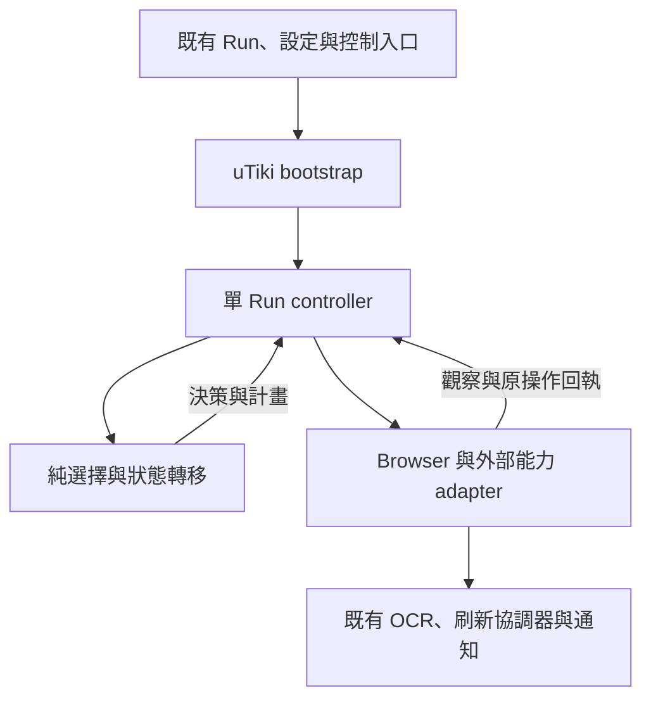

# uTiki 重構計畫

本計畫是中信兄弟與味全龍共用 uTiki 職棒流程的唯一正式施工規格，定義需求、責任、順序與離線完成條件；採用計畫不代表功能已完成。當前接線、下一步及歷史驗證見 [STATUS.md](STATUS.md)，可執行命令見 [測試執行指南](../testing_execution_guide.md)，跨模組限制見 [程式碼邊界](../code-boundaries.md)。

目標是保留使用者可見功能與安全邊界，交付能擴充整個自有職棒模組、責任清楚且可驗證的架構。過渡期間保留既有正式 owner；切換與清理依下列批次的證據進行。

## 0. 使用方式、版本與決策摘要

### 0.1 核對基準

本計畫根據 `OooPeople/tickets_hunter` 的固定審查基準 `9e1b20270c06ab975aea915ea9e29b5940a9e013` 與下方固定版本來源制定；FB 參考基準為 `7f3af935d2a624ad49b59514231d41c701028a3e`。來源連結用於追溯當時判斷，不是持續更新的實作進度。開始工程工作時先核對本地 branch、HEAD、未提交內容與實際 caller；如有新證據，重核對受影響契約並更新 [STATUS.md](STATUS.md)，保留使用者現有工作。

固定基準的正式 caller 仍呼叫舊 workflow。隔離的新 engine 已有一般票數、手動劃位、人工 CAPTCHA、頁內登入、單次提交與部分 CAPTCHA 拒絕處理，尚未切換正式入口；具體完成度以 [STATUS.md](STATUS.md) 和當前程式證據為準。歷史測試數與舊 SHA 的 CI 不構成本計畫施工後的驗證。[S01]

### 0.2 本版已確定的決策

1. **一個 Run 是一個購票任務執行。** 多場比賽使用現有的不同設定檔／任務；不新增跨場次佇列。
2. **每個 engine 管理自身 Run 與一個活躍 tab 綁定。** 外層既有機制處理多任務；不在職棒模組內建立第二套多任務管理器。
3. **同一 Run 可有多個必要 attempt。** 已知 CAPTCHA、登入或選擇拒絕後，依證據重新準備，不等於開始另一場購票。
4. **checkout／人工付款接手邊界是本 Run 的自動購票終點。** 不把抵達付款頁誤稱為付款完成；成功或限購結果不因 URL、設定、auth 或 tab 變更自動清除。
5. **實質重整 controller 核心。** 頁面來源、readiness、未決操作、結果歸屬、停止收尾須重新設計與接線；不是只加幾個旗標。
6. **現有程式按技術適用性保留。** 純規則、身分資料與 browser 接縫可以沿用；不設保留比例，也不為維持既有類別而增加永久相容層。
7. **完整有效政策在地基批次完成。** 保持既有設定存放位置，於組裝邊界產生一致的執行快照；不等正式 UI 切換才補政策版本。
8. **借用 FB 的責任分工與正式接線方法。** 購票的遠端效果、未知結果與重試語意自行定義。
9. **維持吸收 upstream 更新。** 自有變更集中於職棒 family、設定 validator 與少量 host/core 接點；其他平台由 upstream 架構繼續維護。
10. **先完成批次 0，才繼續 OCR、新 attempt、電腦配位與刷新等功能。**

### 0.3 「不要留下技術債」的可驗收定義

本計畫要求：已知會妨礙後續擴充、結果歸屬或正式接線的結構問題，在對應批次內修正；不以「之後再整理」跨過完成條件。無法保證未來需求與網站改版永遠不需要調整，但不能把目前已知錯誤當成既有相容行為保留。

過渡程式僅可在尚未切換的施工階段存在，須有真實 caller、單一 owner 邊界及明確移除批次。正式 runtime 不得保留新舊雙寫、購票 fallback、第二份狀態真相或無出口的 retired 記錄。未驗證的真站差異、未授權推送的 CI，以及明確不在範圍的功能，應如實標示，不能混稱為已完成。

## 1. 範圍與使用者行為

### 1.1 交付範圍

- 中信兄弟與味全龍共用的 uTiki 職棒 family。
- 一般票數、手動劃位模式、支援 tenant 的電腦配位完整流程。
- 既有日期／區域選擇、票種與張數、座位規則、OCR／人工輸入、頁內登入、提交、已知拒絕恢復、刷新與 429。
- 既有設定網頁、current uTiki 行為格式、相關共用設定的正式載入／儲存／熱更新接線。
- Windows x64、macOS arm64 的原始碼啟動、資源路徑與相應驗證。
- 新 owner 正式切換、已接替舊碼清理、效能比較，以及清楚的離線完成紀錄。

### 1.2 本次不建立的機制

- 其他售票平台的同型重構、跨平台 workflow 框架或外掛系統。
- 同一成功 Run 接著買下一場、跨場自動排程、新任務管理 UI。
- 購票狀態的跨程序重啟恢復、持久化事件平台、以 outbox 自動重送購票。
- uTiki 產品設定升級器、舊值 runtime fallback、`ctbc`／`utiki` 行為雙寫。
- 新的產品打包、PyInstaller 成品、安裝包或發布系統。
- 新增設定檔帳密的 Run 中熱載；帳密檔案變更於下一次 Run 載入。
- 自動付款。

測試隔離容器是驗證環境，不屬於產品打包。共用 OCR、accounts、Cookie、browser profile 與 SQLite coordinator 的資料位置及其他平台語意持續保留。`accounts.ctbc_*` 等現行帳號鍵、真實 tenant 名稱或 coordinator scope，不因含有 CTBC 字樣就視為應刪的 legacy。[S14][S18]

### 1.3 Run、停止與人工接手

| 情境 | 既定行為 |
|---|---|
| 週六、週日都要買票 | 建立兩個既有任務，各自 Run |
| 同任務第一次 CAPTCHA 被明確拒絕 | 原 attempt 留下拒絕結果，依恢復規則建立新 input／submit attempt |
| 抵達可歸屬的 checkout | 停止本 Run 的自動購票，保留頁面供人工處理，通知一次 |
| 限購 | 本 Run 保持終局阻擋，不藉設定、帳號或頁面變動自動解除 |
| 一般 pause | 禁止新的頁面變更；保留在途結果、必要只讀核對與本地清理 |
| resume | 重新核對目前政策、文件、選擇、auth、health 與節流；不盲目重跑最後一步 |
| Stop／關閉 | 停止授權新操作；在程序仍存活時完成可做的原結果歸屬與資源收尾 |
| 新 Run 直接接到既有購票／checkout 頁 | 缺少本 Run 可信來源時保持人工核對；不把重新 attach 當成提交資格 |
| 程序崩潰或硬終止後重啟 | 不宣稱已恢復原 attempt，也不自動續送；原未知購票由使用者核對，新的購票從可信起始頁開始 |

只做來源可證實的唯讀核對；tab 已關閉或 provider 已不可用時，記錄無法核對的原因，不要求對不存在的 browser 無限重試。Stop 不保證能撤回已交給 CDP 或售票網站的命令。

## 2. 現有成果的處置

### 2.1 保留、修改與重寫範圍

| 區域 | 處置 | 判斷理由／完成要求 |
|---|---|---|
| tenant／route profiles | 保留並驗證 | 已有家族差異位置；以正式 classifier 整合案例驗證 |
| 純日期、區域、票種與座位規則 | 逐項沿用 | 可獨立接受資料與設定；不依賴 controller session [S04] |
| snapshot／plan／operation 身分 | 保留適用材料，調整契約 | 身分及不可變輸入方向成立；補足 payload 身分與結果所需資料 [S05] |
| browser adapter／production scripts | 保留操作邊界，修改受影響內容 | 不要求重寫所有 DOM；須補完整解析、身分核對與回執 |
| controller 狀態與各 advance 流程 | **實質重寫** | 分離來源、readiness、未決操作、結果、收尾；消除被取代的平行旗標 [S02][S03] |
| pause／close／回執歸屬 | **依新模型重寫** | 原結果不能受「目前可否派送」條件阻擋 |
| policy、ports、bootstrap | 重定必要契約並接通 | 實際能力、tab 綁定與完整設定版本必須一致 [S08][S09] |
| 現有測試與 fixture | 保留有效案例與環境 | 不保留證明錯誤卡住行為的預期；增加有證據時可完成的案例 |
| 舊正式 owner | 切換前維持唯一正式 owner | 新路徑先隔離驗證；批次 5 切換、批次 6 清理 |

保留責任邊界不代表凍結 class tree、檔名或函式簽章。若原有 `InputState`／`SubmitState` 不足以表達新契約，可合併、刪除或改寫；不得只在原旗標外再包一層型別。

### 2.2 本版必須解決的已知缺口

| 編號 | 現況問題 | 本計畫的修正 |
|---|---|---|
| F1 | active 同時當來源與未決操作；首次回讀失敗、Ready 失效後缺乏續跑路徑 | 來源證據獨立保存；所有未決頁面操作有核對入口 |
| F2 | 新派送資格與舊結果處理共用 gate；NO_EFFECT／close 收尾不能正確結束 | 原 claim 比對、結果歸納與目前授權分離 |
| F3 | 座位 payload 識別值在快照邊界遺失 | 保留並驗證計畫、DOM 與 payload 的席位對應 |
| F4 | CurrentPolicyState 與 constructor-only FlowSettings 的版本範圍分裂 | 建立完整有效政策與失效規則 |
| F5 | builder 宣告能力不足；多 tab engine 與單 tab adapter 粒度不符 | 明確依賴、單 Run／活躍 tab 組裝 |
| F6 | wire 解析、fingerprint 與共用 helper 漂移 | 一致解析規則與少量共用讀取定義 |
| F7 | file fixture 未證明正式 classifier、tenant、auth 與 builder 全部相接 | 正式 origin 的完整隔離流程與實際 provider 映射驗證 |

以上源於固定版本的程式與測試審查，不宣稱已在真站重現，也不把尚未開發的功能本身列為缺陷。[S02][S03][S06][S07][S08][S09][S10]

## 3. 目標責任與依賴

### 3.1 執行關係

這是執行協作關係；靜態依賴由下表約束。主迴圈不繞過 controller 執行職棒頁面變更。

### 3.2 責任地圖

| 落點 | 負責 | 禁止承擔 |
|---|---|---|
| `src/nodriver_tixcraft.py` | 既有 Run/tab、路由、設定事件、控制與 health 接點，呼叫家族入口 | 另一份職棒狀態、旁路選票／submit／reload |
| `src/utiki_config.py` 等純設定邊界 | current 格式驗證、有效政策建構所需純資料 | browser、engine、設定 UI I/O |
| `platforms/utiki/bootstrap.py` | 組裝真實能力與單 Run engine | 舊 workflow registry、萬用 service locator |
| `application/engine.py` | 唯一 Run 狀態寫入、派送資格、原結果歸屬、控制與清理 | 所有頁面選擇算法、所有 DOM 細節 |
| application 內必要協調 helper | 依目前責任協調輸入、提交或刷新，回傳決策／結果 | 自有 session mirror、獨立授權或隱性重試 |
| `domain/`、純 profile／selection | 身分、觀察契約、規則、合法轉移與不變量 | browser／ports／settings／大型 I/O util、時鐘讀取、task、sleep |
| `adapters/browser.py`、scripts／codec | DOM/CDP、嚴格解析、claim 下的變更、回讀與結果證據 | 改 session、決定新的購票任務或自動重試 |
| OCR／通知／core adapter | 呼叫既有窄能力、資料與結果映射 | 業務流程 owner 或第二套排程 |
| 既有 SQLite coordinator | 跨程序 interval、permit、lease、cooldown、429 事實 | 本 Run 的選擇／輸入／提交狀態 |
| 既有 UI | 輸入設定、呈現唯讀狀態與理由 | 直接改 engine 欄位、自行推導另一套購票進度 |

只為已有 caller 與差異建立抽象。可新增少量責任明確的 helper 檔，不預定每個 enum、DTO 或小函式都各一檔。不以檔案長度或類別數判斷完成。

共用關鍵字／native setter 維持唯一來源。若 domain 需要大型共用模組中的純函式，應選最小的純依賴接縫；必要搬移需保留其他平台行為與驗證，不複製一份同名邏輯。native setter 由組裝點提供必要 fragment，避免 browser adapter 只為取常數而載入整份共用瀏覽器模組。[S11]

### 3.3 FB 參考的採用範圍

| FB 已落地做法 | 本計畫採用方式 |
|---|---|
| 正式 scanner 回傳 typed result，caller 統一提交與收尾 [F01] | 各購票模式保留特有規則，共用操作／結果契約；結果貫穿正式 caller |
| attempt 保存 owner／取得資源，cleanup 依原 token 收尾 [F02] | 原 operation、submit attempt 與資源分開，清理不能碰新 owner |
| page evidence 與純分類分開 [F03] | browser 提供完整觀察，純規則決定行為，controller 套用 |
| 集中組裝、façade 委派專責服務 [F04] | builder 宣告真實能力；engine 保持唯一 writer，規則有自己的位置 |

FB 的 scan permission 可拒絕舊掃描的本地提交。[F05] uTiki 已可能送出的遠端操作仍須歸屬與核對；暫停後不發新動作，但不丟棄原結果。此處採用 ownership 原則，不複製其 DB commit 語意。

目前無需搬入 FB 的多 target scheduler、持久 runtime repository、通知 outbox、全套 dashboard 傳輸或 updater。若未來有明確的跨重啟通知需求，再單獨評估通知保存；它不能使購票取得 exactly-once 保證。

## 4. Run 內的最小資料與狀態契約

下列名稱表達必要語意，可沿用或調整現有名稱；不要求逐列建立 class。**同一事實只能有一份可修改的權威資料。**

### 4.1 身分與生命週期

| 資料 | 最少內容 | 生命週期／失效規則 |
|---|---|---|
| Run／購票週期 | 沿用 `PurchaseCycleId` 或等價識別 | Run 建立時產生一次；同任務的重試不換 cycle；不再另建同生命週期的 RunId |
| 活躍 tab 綁定 | `TabKey`、session generation、實際 adapter | 換 tab 須明確 retire 原綁定；換綁定不能清掉 Run 結果或未決效果 |
| 可信頁面來源 | 已證實的來源操作、tenant／route／商品接續、當前文件 | 原導航結果確認後建立；page 身分變更後重新證實；不因 policy/control revision 改變就抹掉歷史來源 |
| 完整政策 | 不可變有效值、版本、可否接受新動作及理由 | 原子替換；原 attempt 留下當時版本與所需輸入 |
| 選擇／輸入 readiness | plan、對應文件／選擇／輸入版本及必要證據 | 相關輸入、政策、DOM 或 auth 改變即失效；不刪除來源或原派送事實 |
| OperationRecord | claim、原 stamp、種類、計畫、效果階段、回執、核對進度、資源 token | claim 前建立；完成、人工核對或退休後精確收尾 |
| 提交紀錄（重整既有 SubmitAttempt） | 共用提交 ID、cycle、原商品／選擇／輸入脈絡、automatic 或 observed manual 來源、原結果 | 自動來源參照原 operation／claim；人工來源保存真實觀察證據，不虛構派送 claim；新提交不覆寫舊紀錄 |
| 已知結果 | 原 attempt／操作、分類、來源證據 | checkout、已知拒絕、限購分別保存；未知仍需保留原操作 |
| Run 結果／唯讀 status | 由權威狀態整理的進度、阻擋原因、人工動作、終局 | UI 讀取，不反向授權；成功與限購保持終局 |

`PurchaseKey` 的 auth epoch 是當次購票身分的一部分；已確認頁面來源則保留來源事實，不應把「必須仍等於目前 auth／policy」混成其存在條件。舊操作可被確認成功，但只有符合目前完整政策時才能建立新的 readiness。

提交紀錄共用一套結果處理，不另建 manual session。automatic 必須有原 controller operation／claim；observed manual 必須保存本 Run 已觀察的準備脈絡，以及足以把人工送出事件或其結果連到該脈絡的證據。人工來源不適用「context 必須允許自動提交」的前提，也不能補造自動回執。本文後續的「原 attempt／原提交」包含這兩種可證實來源。

已觀察到人工送出但結果未知時，同樣阻擋程式 reload、換圖及改寫輸入；缺少歸屬證據則保持人工核對，不推定成功或自動恢復。唯一 owner 約束程式的操作；不假設能阻止使用者直接點擊或修改頁面，人工變化必須由觀察納入核對。

### 4.2 控制、操作與業務結果分開

- 控制表示目前可否開始新操作，以及 Run 是否正在停止。
- operation 表示原命令是否尚未派送、正在執行、等待觀察、已結束或需要人工核對。
- 業務結果表示 checkout、已知拒絕、限購等事實。
- `Unknown`／逾時表示停止自動派送並保留原操作，不是「已結束且可以丟掉」。後續可信證據仍可讓原結果變成已知。
- input 與自動 submit 的派送階段參照 operation，或由它產生唯讀投影；不得各自保存可獨立修改的 Awaiting／Held 布林值。提交業務結果由同一份提交紀錄保存，人工與自動來源不各建結果系統。
- 已建立 checkout／限購終局後，普通 tick、reload、policy、auth 或 tab 更新不能重開購票。

用純轉移函式或等價的集中規則產生下一狀態，再由 controller 套用。不要求通用 event bus、事件溯源或 reducer framework。

### 4.3 新派送與原結果歸屬是兩個判斷

**新派送資格**需要核對：目前 Run/control、有效政策、tab/document、該步驟需要的商品／auth、readiness、現有未決操作、health 與必要的 coordinator permit。

日期／區域的觀察與授權導覽依可信 tenant、route、document、候選及來源取得資格，不要求預先登入或已有 verified auth epoch。只有實際需要 session／auth 身分的操作才加入相應前提；不能為了建構共用 PurchaseKey，將日期／區域也鎖在等待登入。

**原結果歸屬**依來源核對：自動提交／程式操作核對原 claim、operation 與 stamp；人工提交核對共用提交 ID、原準備脈絡及 observed manual 證據。兩者都須核對結果種類、來源文件或已證實的目的頁關係，以及與既有事實的一致性。不能再要求原 policy/control 必須等於目前版本。

回執匹配不代表結果可以推進目前任務。先結束原操作，再獨立判斷目前是否允許下一步。舊 Run 的回執不改新 Run，也不釋放新 Run 的資源。

### 4.4 派送與並行規則

1. 由 controller 在短同步區段內驗證、建立 claim、記錄原計畫，再釋放同步區段執行 I/O。
2. 同一活躍 tab 同時只允許一項會變更頁面的操作；重複 tick 參照原 operation，不建立第二份命令。
3. 不在等待 CDP、SQLite、OCR、通知或計時器時持有 session 長鎖。
4. 原生命令交給 adapter 後，pause 不承諾能撤回它；只能阻止尚未開始的新操作及同操作後續未授權步驟。
5. adapter 的派送前檢查應使用原 grant、tab/document 及可用的撤銷資訊；跨非同步邊界產生的競態仍以原回執與核對處理。
6. OCR 計算和只讀觀察可以獨立進行，但回來的結果不得直接修改 session 或頁面。
7. 恢復所需的新頁面動作使用新的 claim，連回原 rejected attempt；不重用原 submit claim。
8. 取消、例外或 timeout 只有在可信邊界能證明尚未派送時才算 NO_EFFECT。否則保留已知最晚效果階段。

### 4.5 效果證據與下一步

| 證據 | 原操作處理 | 是否取得新操作資格 |
|---|---|---|
| `NO_EFFECT`，且與原 claim 一致 | 明確結束此操作；保留原因 | 不自動取得；重新觀察並通過目前 gate 才可新 claim |
| `LOCAL_MUTATION` | 核對實際欄位／選擇；必要時進已知清理 | 回讀完成前不重做同一寫入 |
| `REQUEST_DISPATCHED` | 記錄已越過請求邊界，等待可歸屬結果 | 不因命令成功返回就送下一次 |
| `REQUEST_POSSIBLE` | 保留原操作與不確定性 | 沒有已知結果不能自動重送 |
| 不匹配／互相矛盾的回執 | 拒絕套用，保留診斷與原未知狀態 | 不授權新動作 |

效果證據與「目前還不知道」須分開。單純在途、timeout 或 stop 不自行升格為已知越過 request boundary；原 adapter 後續提供可信、同 claim、可證明派送前拒絕的最終 NO_EFFECT，仍可結束原操作。若已有可信證據顯示越過可能對外請求的派送邊界（含該邊界的 REQUEST_POSSIBLE），相矛盾的 NO_EFFECT 不能將它降級；保留矛盾與原阻擋。重複相同回執冪等處理，已知終局不被不匹配結果清除。

對已證明只有本地修改、原 writer 已結束且沒有遠端 request 邊界的操作，回讀也可能證實「已被可歸屬的人工修改取代」或「已完整觀察的局部結果」。此時可結束原本地操作並保留來源，但不沿用舊 readiness；改核對目前人工值，或依該頁型授權必要清理。任意 mismatch、來源不明或 writer 尚未結束不符合此出口；未知 submit／navigation／reload 也不能套用。不得為了符合舊 plan 自動改回人工已修正的值。

### 4.6 等待、重新核對與逾時

| 等待對象 | 下一輪做什麼 | 完成／退出 |
|---|---|---|
| 日期／區域導航 | 只讀辨認目的 document、route、商品與原來源 | 證實接續後記錄來源並結束原 operation；未知則保留 |
| 票數／座位操作 | 對原 plan 讀取目前選擇與 payload | 符合後結束操作；確定本地局部結果時依 4.5 結束／準備清理；讀取失敗仍保留回讀入口 |
| 登入填值／欄位 audit | 核對原輸入意圖或可證實的人工取代 | 符合或符合 4.5 的本地取代出口後結束；填入成功不等於已登入，不改回人工已修正的欄位 |
| 提交 | 觀察可歸屬 checkout、拒絕、限購或已知結果 | 得到結果後歸屬原 attempt；期限到進人工核對，不重送 |
| CAPTCHA reset | 核對原 reset 的文件、空欄、圖片與控制項 | 期限內新題證據成立才可準備輸入；逾時不恢復過期資格 |
| 刷新 | 分別核對 permit 與 reload／新文件 | request/lease 與 browser 效果各自收尾 |

證據逾期後仍可用來說明原操作發生了什麼，但不因此恢復過期 OCR、input readiness、reset 授權或新派送資格。等待使用可控制的單調時鐘與既有節流；不加入無限忙迴圈或固定快速重點擊。

### 4.7 失效、pause 與 stop

| 事件 | 應撤銷 | 必須保留／後續處理 |
|---|---|---|
| 同文件選擇改變 | 受影響的 selection/input readiness | 可信頁面來源、原 operation |
| 有效政策改變 | 受影響計畫及新派送資格 | 原政策快照、原派送與結果；舊目的頁可信不等於符合新條件 |
| 無效設定 | 所有依賴該設定的新頁面變更 | 上一有效值只供歸屬與診斷，不暗中繼續購票 |
| pause | 尚未開始的新 mutation | 在途回執、必要只讀核對與資源清理；結果確認不自動 resume |
| stop／close | 本 Run 後續自動動作 | 最小原操作記錄、未結結果與自身資源 token |
| 文件改變 | 舊文件的準備資格 | 先核對是否屬原導航／提交／刷新，再建立新文件來源 |
| tab 綁定變更 | 舊 adapter 的新動作 | 原 Run 結果與未決效果；新 tab 不能解除未知提交 |

stop 後的 retired 記錄至少保存原提交來源、原 claim（若有）、attempt／plan 的歸屬資料、人工提交的來源證據（若適用）、已知效果、未結工作及資源 token。回執結束、相關 callback／task 已處置、資源精確釋放後即可收斂；未知結果保留最小摘要與人工狀態，不保留不再需要的整份 DOM 或無限墓碑。

清理不能使 Run 復活。程序硬終止後，本計畫不提供持久恢復；不能宣稱這些記憶體記錄能跨重啟存在。

## 5. 完整有效政策與設定接線

### 5.1 一份執行快照，多個既有存放來源

在組裝／設定邊界產生不可變的 effective policy，controller 每次只接收一份已驗證的完整快照。這不是把所有設定搬進 `utiki`，也不是增加第二份 JSON；原有來源位置如下。[S08][S12][S14]

| 執行行為 | 既有資料來源 | 接線要求 |
|---|---|---|
| 票種、座位排序、手動／電腦模式 | `utiki` | 只接受 current 行為格式 |
| 日期／區域的啟用、關鍵字及排序 | `date_auto_select`、`area_auto_select` | 納入計畫版本與重新選擇判斷 |
| 日期／區域 fallback | `date_auto_fallback`、`area_auto_fallback` | 原有語意保留，不在 adapter 偷加 fallback |
| 排除規則、購票張數 | `keyword_exclude`、`ticket_number` | 舊選擇完成後仍須核對是否符合新值 |
| 相鄰需求 | `advanced.disable_adjacent_seat` | 現行值直接映射 `allow_non_adjacent`：true 允許在沒有相鄰區塊時考慮不連座；`row_asc_aisle` 等既有排序仍保留其相鄰要求，不做布林反轉 [S04] |
| OCR、強制提交及其相關選項 | `ocr_captcha` | 保持共用來源，依 5.3／5.4 執行 |
| 本機刷新間隔、排定時間 | `advanced.auto_reload_page_interval`、`refresh_datetime` | 形成刷新意圖，不直接呼叫 reload |
| 跨程序刷新設定 | `global_settings.json` 的 `utk_sports` | 保留 global settings 自有 revision 與 coordinator scope，含 enabled 設定；不複製進每個 profile |
| 帳密與 auth | 既有 credential provider、頁面觀察與 verified auth | 秘密不屬 policy；輸入版本、憑證來源與已驗證 auth 分開 |

此表列出必須對照的已知行為。實作前仍要查完整正式 caller，補齊當前真正影響購票的值；不能以表內未列某個現行有效選項為由直接丟掉它。通知樣式、日誌格式等不改變購票決策的選項，不應無故使選擇失效。

### 5.2 原子更新與失效

- 純 validator 產生「有效快照」或「明確錯誤」，不得零散更新 engine 欄位。
- revision 由有效語意變化推進；相同有效值、JSON 空白或 unrelated setting 不建立假的購票變更。
- 一個總 revision 可以配合純比較函式決定受影響範圍，不必為每個欄位建立版本管理框架。
- 政策改變時禁止舊計畫取得新派送資格；原導航、填值、提交仍用原快照核對。已可信抵達的頁面可以保留來源，但舊票數／座位不能被直接標成符合新政策。
- 無效設定要讓使用者看到原因，並阻擋受影響的新操作；不能暗中用上一份值繼續購票，也不因錯誤設定遺失原結果。
- 保持同一 Run／engine。hot reload 不透過重建 engine、清空 attempt 或更換 cycle 解決失效問題。
- global settings 的 revision 用於設定內容的樂觀並行控制；不把它當成 permit、reservation 或 cooldown 的版本，也不新增正式 coordinator API 不存在的 revision 欄位。[S24]

### 5.3 OCR 與自動提交的真實語意

現行正式 workflow 以 `ocr_captcha.enable AND ocr_captcha.force_submit` 決定自動提交；不是只讀 `force_submit`。[S13]

| OCR enable | force_submit | 輸入與送出 |
|---|---|---|
| false | false | 人工輸入、人工送出 |
| false | true | 人工輸入、人工送出 |
| true | false | 可辨識／填入；辨識不可用時可人工輸入；人工送出 |
| true | true | 可辨識或人工輸入；全部準備證據成立時，才可由 controller 建立一次自動 submit |

不新增與這兩個欄位重疊的持久化 `auto_submit` 設定。可在 effective policy 內導出同名唯讀值。

停用自動提交會撤銷尚未開始的 submit 資格，不會抹去已派送的 attempt。即使設定已關閉，晚到 checkout 仍應歸屬原 attempt。人工送出依 4.1 的 observed manual 來源記錄；沒有 controller 派送 claim 不代表可以忽略已觀察到的人工提交。無法歸屬的頁面變化保持人工狀態，不能補造一份成功的自動 attempt。

### 5.4 OCR provider 生命週期

本版保留目前 **Run 啟動時建立 OCR provider** 的產品範圍，不新增模型熱切換管理器。現行啟動程式只在 OCR 啟用時初始化 provider，設定 reload 不會自動重建它。[S15]

- 分開表達「政策允許 OCR」、「本 Run 有相容且可用的 provider」、「本次答案仍屬目前題目」。
- enable 由 true 變 false 時撤銷後續辨識／填值資格；已開始的辨識可以收尾，但結果不得寫入。
- enable 由 false 變 true 而本 Run 沒有 provider 時，呈現需要重新 Run 才能使用辨識；人工輸入路徑仍可用。不把 `None` 當成可呼叫 provider。
- 只有實際影響 provider 初始化的設定（例如目前 factory 使用的模型路徑、選型與 beta 選項）採下一次 Run 生效；保存本 Run 的初始化規格與實際成功建立的 provider／fallback，不能假稱使用尚未載入的新模型。
- 當正規化後的目前初始化規格與本 Run 綁定規格不相容、必須重新初始化時，本 Run 停止後續 OCR 辨識／填值，顯示需重新 Run，保留人工輸入與既定提交政策。不能繼續呼叫不相容的舊 provider；啟動時已記錄的正常 factory fallback 也不能被誤判成後來的設定變更。
- 圖片取得策略只依正式 adapter 實際支援的能力處理，不因共用設定存在同名選項，就宣稱 uTiki 已支援。每題圖片的內容／URL／load 身分則即時核對；新題或文件變更立即使舊答案失效，不能延到下一次 Run。
- provider 不可用不等於禁止人工輸入。enable 與 force_submit 同時為 true 時，人工輸入也必須通過相同回讀與提交條件，才能自動送出。
- 設定有效但 provider 不可用，不屬於無效政策，也不撤銷無關的可信來源或已完成選擇。使用者已人工修改欄位後，晚到 OCR 不得覆寫。
- OCR 失敗、停用或需要重啟的狀態是可見的使用者狀態，不是繼續反覆初始化或刷新圖片的理由。

若未來決定支援 Run 中初始化／更換模型，應另補 provider lifecycle 的明確需求、資源收尾與整合測試；本次不能靠測試替身假裝正式入口已具備。

### 5.5 帳密、人工修改與 auth

現有主迴圈沒有 accounts 檔案熱載路徑；本版不新建這項功能。設定檔帳密改變在下一次 Run 載入。[S12] 同 Run 的已知登入拒絕恢復，依既有人工頁面操作能力進行。[S16]

1. 首次填值區分設定檔來源與已存在的人工欄位，不覆寫使用者已填的內容。
2. 原 attempt 保存必要的輸入來源／不透明版本，敏感值不進 status、log、fixture 或文件。
3. 已知登入拒絕後，不再次使用同一份已被拒絕或無法判斷是否改變的輸入自動循環送出。
4. browser observation 必須能證明相關欄位在正確文件與拒絕脈絡下有可歸屬的修改；僅有「非空」或 `ready=true` 不夠。可使用短期記憶體中的不透明比較結果，不新增可長期追蹤密碼的 digest。
5. 人工修改被證實後，輸入來源轉為 manual，重新回讀與核對；不能又用舊 config 自動填回。
6. 「欄位已改」只允許依完整條件準備下一個登入／購票 attempt；不代表登入成功，不因此推進 auth epoch。
7. auth epoch 只由正式 auth provider 的已驗證邊界推進。若使用者已人工登入，仍須確認該 auth 與目前 tenant／文件的關係。
8. 正式 adapter 無法提供所需證據時保持人工接手；不能在測試裡增加假的 credential revision，就宣稱正式恢復完成。

初始 auth epoch 表示正式 host／provider 已確認的 session 綁定世代，並不等於已登入成功；匿名／未知登入狀態與「沒有可驗證的 session 世代」也要分開。頁內登入準備、承載該輸入的首次合法提交，以及服務端接受登入的結果分別表達，避免要求先登入成功才能送出登入資料的循環。不得用固定 `AuthEpoch(1)` 補出正式入口不存在的能力。[S05]

## 6. Browser、身分與組裝契約

### 6.1 完整資料穿過邊界

browser 先觀察、嚴格解析，再交純規則決策。任何會影響 commit 的資料，都須保留到計畫、派送前核對和回讀。

| 資料 | 必須保留的證據 |
|---|---|
| 日期／區域候選 | 穩定商品身分、頁型／tenant、原生可用動作、可售狀態 |
| 一般票數 | 原始選項身分、票種、可售／上限、實際張數及目的商品 |
| 保留座位 | DOM 席位、payload key／席位識別、票種／價格區、可售狀態及實際選取 |
| 電腦配位 | 原生動作、`ATYPE`、performance／group／price area／product、來源與目的文件 |
| CAPTCHA | 原圖片內容或可證實內容變更的身分、欄位、reset 控制項、文件與輸入版本 |
| 頁內登入 | 欄位來源、可歸屬的輸入變化／回讀、獨立 verified auth |
| 提交 | 原準備計畫、實際 payload、需要的勾選控制項、可用 submit 與原 attempt |

現有座位快照使用 `Object.values(window.seats)` 只保留部分座位欄位，會丟失 payload key。[S06] 修正須涵蓋 snapshot script、codec、domain plan、selection、seat readback 與 submit guard。只證明「兩張、同票種」不能證明是原來選的兩席。

不要求 DOM id 等於 payload key；要求有經驗證、可往返核對的對應。若頁面資料無法建立對應，先阻擋該操作並補證據，不能靠顯示文字或陣列順序猜測。

### 6.2 嚴格解析與共用 helper

- 統一 wire schema 的必要欄位、可選值、整數、布林、缺值與錯誤處理。若站點真的提供數字字串，只在明確允許的欄位接受規範格式；不通用套用 truthiness／`int()`。
- malformed snapshot 回傳可辨識的解析失敗；不得默認成可售、零張、空選擇或「一定沒有效果」。
- 集中重複的頁面身分、座位映射、輸入 fingerprint 及必要 DOM 讀取 helper；以實際共用 caller 為準，不建立通用 script framework。
- production script 的 resource 組裝要有固定依賴、唯一路徑與可測試輸出，Windows／macOS 不依賴目前工作目錄。
- Python 與 JavaScript 若都有相鄰／身分判斷，使用同組代表資料驗證語意一致；抽出 JS helper 不能自動證明跨語言規則一致。
- 把便宜且屬同一觀察階段的 DOM 讀取合併，以減少 CDP 次數；跨 await、導航或人工修改後，不能沿用未再驗證的舊 snapshot。

### 6.3 派送前的窄核對

命令應只在原授權操作內做必要 preflight 與單次原生動作。核對 tab、文件、route/query、tenant、商品、原選擇、輸入、控制項與實際 payload。任何不一致都回報具體證據，不隱藏重試。

提交前的核對應盡量在同一頁面執行區段完成，以縮短觀察與動作的間隔；不宣稱 CDP 與遠端網站之間可取得真正原子交易。跨邊界失敗仍依第 4 節效果證據處理。

### 6.4 Ports 與 bootstrap

目前 builder 的宣告能力與 engine 實際使用的 purchase／auth 方法不一致。[S09] 改成由組裝點明確提供：

- 綁定本 Run 活躍 tab 的 browser 觀察與操作能力。
- 真實 auth、既有 credential 來源及必要的人工變更觀察。
- 當前有效政策、單調時鐘與控制事件。
- 可選但明確可用性的 OCR provider。
- 既有 coordinator 的窄 adapter、通知啟動能力及 host health 接縫。

可以使用數個有職責的 Protocol；不把所有方法集中成萬用 port，也不要求為每個函式建立 interface。必要能力缺失在組裝時明確失敗；不要靠 engine 內部 `cast`、`getattr` 或空方法，直到購票才發現缺少能力。

engine 不接受任意 tab key 後再把操作送給固定另一個 tab。builder／adapter 必須驗證綁定；換 tab 必須經明確的綁定生命週期，不透過改字串偷換。

## 7. 購票模式、輸入與已知結果

### 7.1 三種模式

| 模式 | 必須接通的完整切片 | 模式邊界 |
|---|---|---|
| 一般票數 | 日期／區域 → 一般票數頁 → 票種與張數回讀 → 登入／CAPTCHA → 提交 → 可歸屬結果 | 核對必要商品身分；不能拿保留座位的結果冒充 |
| 手動劃位模式 | 日期／區域 → 保留座位頁 → 依政策選席 → DOM／payload 回讀 → 輸入 → 提交 → 結果 | 「手動劃位」是站點模式；模組仍可依規則選席。部分選席不能直接提交 |
| 電腦配位 | 支援 tenant 的原生區域動作 → `UTK0201_001` → `ATYPE` 與商品接續 → 票數／輸入 → 提交 → 結果 | 不直拼 URL，不偷偷退回手動或一般票數模式 |

三者共用操作／結果歸屬契約，各自保留候選、選擇、readiness 與恢復差異。新增模式的差異應放在對應 profile、純選擇與 adapter，不在主迴圈新增另一套流程。

### 7.2 CAPTCHA／OCR 輸入

1. 取得圖片時保存原 cycle、tab、document、題目身分、輸入與政策版本。
2. OCR 回傳後先核對仍是同一有效題目與允許的操作；舊答案可以結束其計算，但不能填入新欄位。
3. 寫入須由 controller 授權，並回讀實際欄位與頁面要求的控制項。辨識成功、setter 成功返回都不等於 input ready。
4. 人工輸入也由相同觀察／回讀建立 readiness；不得因是人工就跳過選擇、文件或 auth 核對。
5. 一個輸入操作首次回讀尚未一致時保留原計畫，下一輪只讀核對；不重複 setter。
6. input ready 之後仍需第 6.3 節提交前檢查；輸入與提交不是同一個不可分割的布林值。

### 7.3 CAPTCHA 已知拒絕

原 submit attempt 必須先有可歸屬的 CAPTCHA 拒絕。恢復依序：

1. 只關閉該已知彈窗，回讀已關閉。
2. 清空對應欄位，回讀確實為空。
3. 對經驗證的 reset 控制項執行一次換圖。
4. 在期限內證實同文件、空欄位、可用控制項與不同圖片內容。
5. 建立新的 input context；重新核對目前政策、選擇、auth 與欄位。
6. 自動提交政策成立才建立新的 submit attempt；否則等待使用者送出。

每一步需要自己的授權與效果核對，可以由同一恢復協調器串接，不能一個過期 grant 無條件包辦後續所有 mutation。圖片 query 改變或按鈕 callback 返回，不足以單獨證明新題內容。換圖結果不明、跨文件、逾時或停止都不重點擊。

原 attempt 保留已知拒絕結果；新題不是清空整個 submit state 的理由。只有新的、可歸屬已知拒絕，才可能再啟動下一次相應恢復；沿用既有間隔，不增加請求頻率。

可歸屬的人工提交已知拒絕也使用此恢復：controller 建立新的恢復 claim，連回同一份 observed manual 提交紀錄，不把原人工動作改記為自動提交。恢復完成仍遵守目前 OCR／force_submit 政策；原本需人工送出的流程不因此變成自動送出。只有彈窗文字而沒有原準備／提交關聯，不足以授權自動恢復。

### 7.4 其他結果與恢復

| 已知證據 | 後續 |
|---|---|
| 登入失效 | 記錄原拒絕；依 5.5 等待可證實的新輸入或已驗證 auth，再重新準備 |
| 一般票數選擇衝突 | 依該頁型清理原選擇；需要 reload 時走第 8 節，再確認新文件與來源後重選 |
| 保留座位衝突 | 核對原席位與局部選擇，按該頁型清理；不得把舊 payload 視為新可售席位 |
| 電腦配位衝突 | 使用電腦配位專屬選擇／商品身分與清理，不混用其他模式 |
| 限購 | 保存本 Run 終局；不換身份、設定或重載自動解鎖 |
| 可歸屬 checkout／成功交接頁 | 原 attempt 得到已知結果；停止自動購票並通知，人工付款 |
| 未知彈窗、商品／來源不明、可能提交但沒有結果 | 保留證據，停止會破壞證據的新動作，交人工核對 |

衝突恢復只有在原提交已被證實拒絕後才能執行受控 reload。局部清理成功、清理 callback 返回或 permit 已核准，都不是新文件已就緒。三種模式各自有正常恢復與部分失敗案例。

### 7.5 通知

通知消費已確認的結果，不能決定購票是否成功或觸發重送。依 Run 與原結果識別去重；重複 tick、相同回執與晚到結果不重複啟動同一通知。

既有通知 wrapper 有啟動背景執行緒後返回 `None` 的方法，並不提供訊息已送達的可靠回執。[S21] adapter 應分清「已嘗試啟動」與「已送達」；不要對同步啟動函式亂用 `await`，也不宣稱送達保證。通知失敗留在通知狀態，不回復 submit readiness。本版不建立持久 outbox。

## 8. 刷新、coordinator 與 host 控制

### 8.1 同一 owner 的資格與優先序

先判斷某動作是否允許，再比較優先序：

1. 未決／未知提交：保留證據，禁止一般 reload、導覽、換圖、改寫選擇／輸入。
2. 已知拒絕的可歸屬恢復：只允許對應恢復動作；所需 reload 仍通過同一刷新接縫。
3. 已就緒且身分有效的購票：撤銷尚未 commit 的一般刷新。
4. 無有效購票計畫：依健康、政策、排定時間、interval、cooldown 與 coordinator 決定刷新。

即使 permit 已 commit，只要 browser reload 尚未派送且現在不宜刷新，仍可放棄該次 reload；不得退還已消耗的共享 pacing，也不能保存 permit 供之後任意使用。若 reload 已可能派送，先核對其原結果，不能直接改做提交。

### 8.2 沿用 SQLite coordinator 的真實語意

沿用現有資料庫、scope、interval、request／reservation／permit、probe lease 與 cooldown，不建立鏡像 registry，也不改 schema 來配合 controller。[S19]

| coordinator 邊界 | 必須保留的語意 |
|---|---|
| reserve | 不等於獲准發請求，且尚未消耗 pacing |
| commit reservation | 依現有結果取得當次授權；不把成功查詢當成新 permit |
| 重播 `already_committed` | 可能有 permit ID，但 `granted=False`；不能延遲再 reload 一次 |
| renew probe lease | True／False／None 分別處理；None 是所有權未知 |
| release／cancel | False 可能代表資料庫失敗，不能直接寫成已清理 |
| 429 report | 只接受可信事件並按原識別去重；不能從普通 timeout 猜 429 |

實際方法與型別以既有 API 為準，adapter 保存原 token／request ID 及 typed result。不要使用一次包辦 reserve+commit 的便捷輪詢方法，繞過中間必要的購票 preflight。

### 8.3 一次刷新序列

下列 reserve／commit 序列適用於共享協調啟用時。明確停用 `utk_sports.enabled` 時，依原刷新原因及 `apply_local_interval` 保留既有本機間隔語意，並維持 owner／文件／控制核對；先精確處理既存 shared request 或 recovery probe，派送前重驗 enabled。排定刷新原本不附加本機間隔，不能在重構時無意延後。資料庫失敗或所有權未知不能被當成「設定停用」而轉入本機刷新；不新增或宣稱現有獨立本機 429 cooldown。兩種設定分支共用 controller 的唯一 reload 接縫，不各建 runtime registry。[S24][S17]

1. controller 建立含原文件與政策的 refresh intent。
2. 向 coordinator reserve，保留 request／reservation 身分。
3. 回來後重新核對 control、文件、購票 readiness 與優先序；不符則精確 cancel 本次 reservation。
4. commit reservation；保留 commit 結果與未知狀態。
5. browser 派送前再做本地資格核對；有授權且仍有效才 reload 一次。
6. 保存 reload 效果證據，等待可歸屬的新 document。
7. 新文件出現後通知 host 重新執行 health／Cloudflare gate，通過後才繼續購票。

至少分開記錄「reserve／commit 結果未知」、「reload 可能派送」、「新 document 已證實」。不能把三者折成 `reload_failed` 後再次刷新。

pause／stop／late receipt 的資源操作使用原 token；A 的清理不能釋放 B 的 lease。清理失敗保留可見狀態與有界重試／期限；未知所有權不能偽裝成成功釋放。租約及 pacing 的有效性由 coordinator 決定，不由本機猜測復原。

### 8.4 主迴圈與 core 的接點

正式切換前逐一接管：[S17][S20]

| 現行接點 | 新責任 |
|---|---|
| `check_refresh_datetime_gate()` | 形成排定刷新／控制事件，由同一 owner 仲裁；不能直接呼叫舊 reload |
| `refresh.health_check` | 先拆清只讀觀察與會 reload 的恢復；不可因名稱叫 health 就當純 getter 注入 |
| Cloudflare／challenge handler | 若會改頁面，須取得同 owner 授權或明確 handoff；未知 submit 期間禁止破壞證據 |
| 同 URL 文件變更通知 | 以 document 身分更新，清除舊 health／challenge clearance；不能只比 URL |
| tab 關閉、stop、例外與 finally | 交回本 Run 的退休／收尾入口，不創建第二份狀態 |
| route → family 呼叫 | 正式 owner 唯一；結果與必要事件回到原 caller |

host 可以先做真正只讀的頁面觀察；會點擊、reload 或導覽的「健康恢復」必須列入副作用盤點。已知新 document 無論來自受控 reload、提交或其他已證實導頁，都不能沿用舊文件的 health clearance。

排定刷新／開賣時間尚未到時，仍執行必要的只讀 health 觀察，以及通過同 owner 核准的 429／challenge 恢復；購票動作仍受時間 gate 限制。不得把原本在時間 gate 前的 health／429 處理整批移到時間到達後，讓已發生的 cooldown 延後才開始。未知提交的保留證據規則仍優先。[S20]

這些接點須在隔離 host harness 先驗證，批次 5 再接正式主迴圈。不得等三種購票流程都做完後，才發現外層仍可直接刷新同一張頁面。

## 9. 施工順序與批次完成條件

順序為 **前置 → 0 → 1 → 2 → 3 → 4 → 5 → 6**。批次 0 解決目前已知地基問題；批次 1–6 接續原計畫的功能切片。批次 4 依賴電腦配位與受控刷新，可提前做獨立的登入觀察，但不能提前宣告整批完成。

每批都要接通「實際輸入 → 授權 → 動作 → 回執／觀察 → 可繼續或明確結束」。新增型別、檔案或孤立測試不算完成。每批保留可回復的 source 變更邊界；回復仍只有一個正式 owner，不新增 runtime fallback。

### 9.1 前置盤點與基線

**工作**

- 核對 HEAD、分支、未提交內容及 repository 現行工程指示；不覆蓋其他工作。
- 追查正式 route、舊 workflow、新 bootstrap、設定 UI／load／save／reload、auth、OCR、通知、health、challenge、refresh 和 cleanup 的 caller。
- 為每個會改職棒頁面的入口確認 owner、授權位置、效果回報及最終接替批次；記錄於現有邊界文件／測試，不新建永久 catalog。
- 讀取現有純規則、DOM、file browser 與 production-origin 測試，分清有效產品要求、尚未實作功能及舊 gate 故障。
- 先取得受影響測試及可重現效能的基線；實際錯誤如實分類，不能把 baseline failure 寫成新版本通過。

**完成條件**

正式入口與主要副作用 caller 無未釐清的黑盒；基準能重現，已知失敗有根因與影響範圍。切換前正式執行仍只有舊 owner，新流程僅在隔離路徑執行。

### 9.2 批次 0 — 核心地基重整

此批不是把新旗標疊到舊旗標上。允許大幅改寫，但依必要責任切片，避免同時重寫所有 DOM 與純算法。

| 切片 | 主要實作 | 必要完成證據 |
|---|---|---|
| 0A：政策與組裝 | 完整 effective policy、原子更新、單 Run／活躍 tab、明確能力依賴、真實 host/provider 接縫設計 | 相關政策變動可觀察；不重建 engine；必要能力缺失與 tab 不合在邊界失敗 |
| 0B：操作與生命週期 | 分離可信來源、readiness、operation、submit attempt、業務結果、control；重寫 advance／reconcile／pause／close | quantity／seat／login 可重讀；舊結果不被新政策擋掉；原 claim 收尾且不重送 |
| 0C：資料與操作邊界 | 保留 seat payload 身分，統一 codec／必要 helper、submit guard、native setter 接縫 | 相同票數／票種但不同席位被拒絕；malformed wire 明確失敗；有效行為維持 |
| 0D：代表性整合 | 使用真實 classifier／tenant／bootstrap／adapter／script 的 production-origin 隔離流程 | 至少一條目前可支援的完整購票切片到已知結果，含延遲回讀及政策／控制介入 |

0A 不要求提前做完 OCR 或 coordinator 的全部功能；須先定義所需資料與能力，後續批次才接入其真實實作。未接入的能力明示不可用，不使用空實作或假的成功回執。

**此批必過的事件序列**

- 票數、座位、登入填值首次回讀不一致，後續回讀一致：只 mutation 一次，最後能結束原操作並繼續。
- 本地登入填值已結束、首次 audit 失敗後使用者作可證實修改：原本地操作能結束，核對新人工值後繼續，原 setter 只執行一次且不覆寫人工修正；未證實的 mismatch 仍不解鎖。
- readiness 失效後保留可信來源，能在新政策下重新計畫，不永久卡住也不放行舊 plan。
- 舊 plan 兩張、等待中改成四張：核對兩張原操作完成，但不標成符合四張的新 readiness。
- 導航派送後 pause／resume：可歸屬原目的頁，沒有第二次原生 click。
- submit 可能派送後關閉自動提交／改設定：原 checkout 仍能歸屬，不再送第二次。
- timeout 進人工核對後晚到已知結果：可收斂原 attempt，不能恢復未授權派送。
- 在途 stop／close 後收到可信、派送前拒絕的原 NO_EFFECT，或可歸屬結果返回：處理原資源與結果，不復活 Run、不清新 Run 資源。
- REQUEST_POSSIBLE 沒有新證據：持續阻擋破壞證據的動作；沒有以 timeout 解鎖。
- 重複／相矛盾回執：同事實冪等；有可信 request-boundary 證據後的矛盾 NO_EFFECT 不解鎖，單純在途未知不拒絕可信最終 NO_EFFECT。
- payload 席位不同但數量／票種相同：提交前阻擋。
- Run 已 checkout／限購後改 URL、policy、auth、tab：終局不清除。
- 缺必要 port、adapter 綁錯 tab：組裝／呼叫邊界有明確失敗，不能靜默操作另一頁。
- 尚無 verified auth epoch 時，可信起始頁仍能完成日期／區域的觀察與授權導覽；需要 session／auth 身分的後續操作才因證據不足阻擋，不靠固定 fake epoch 通過。

**批次 0 出口**

F1–F7 有實際修正與上述證據；替代模型接管原責任，被取代的平行狀態與未使用橋接在本批刪除。未達出口不開始疊加批次 1 功能。若新增證據要求調整契約，先同步本計畫與相應測試，不另外維護一份衝突設計。

### 9.3 批次 1 — CAPTCHA／OCR 與新的 attempt

**接線**

從現有已知 CAPTCHA 拒絕的隔離檢查點，接到新題證明、輸入 context、真實 OCR 能力、人工輸入、回讀、政策控制的 submit，以及原結果觀察。使用批次 0 的 cycle／operation／attempt，不另建恢復 session。

**完成證據**

- 一般票數與手動劃位均能在已知拒絕後取得新題，建立新的 input；政策允許且全部條件通過時，只送一個新 submit attempt。
- 四組 OCR／force_submit 政策均符合 5.3；停用 OCR 但 force_submit=true 仍不自動送出。
- provider 不可用時保留人工路徑；啟動 disabled 後同 Run enable+force_submit，人工填值可依條件完成一次自動提交。
- 原圖片晚到 OCR、同 URL 新圖片、人工先修改欄位、policy／control 改變，均不被舊答案覆蓋。
- 換圖未知、原提交未知、局部清欄、逾時、停止不重點擊、不重送。
- 真實 Run 入口、重新啟動與來源不明既有購票頁的行為成立；不新增 UI。
- 人工送出後的可歸屬 CAPTCHA 拒絕能進共用恢復與新輸入；auto-submit 關閉時仍等待人工再送，沒有虛構的原自動 claim。人工可歸屬 checkout 同樣終局／通知一次；沒有原準備關聯時保持人工核對。
- 使用 production script 的 browser 流程，不能只 fake 一個 OCR 字串和 `ready=true`。

真站圖像／控制項未證實的差異記為待人工驗收；不能放寬圖片或來源身分讓離線案例通過。

### 9.4 批次 2 — 電腦配位完整路徑

**接線**

補支援 tenant 的日期／區域原生動作、`UTK0201_001`、`ATYPE` 與商品接續、該頁型票數選擇、登入／CAPTCHA、提交與結果。選擇規則、adapter 與 fixture 都接到正式契約。

**完成證據**

支援的 tenant 可走到隔離 checkout／已知拒絕；不支援 tenant、直接進目的頁、錯 query／商品、原生動作可能派送但未證實均阻擋。正常與拒絕後的 OCR／人工路徑沿用批次 1。不能只驗證「進得去票數頁」，也不能用 fallback 隱藏該模式未完成。

### 9.5 批次 3 — 購票／刷新仲裁與 429

**接線**

依第 8 節接真實 coordinator 的窄 adapter、controller refresh intent、reserve／commit、browser reload、原結果與新文件；建立 host harness，證實 health／challenge 不會旁路變更頁面。

**完成證據**

- 無票正常刷新、購票 ready 與 reserve／commit 競爭、重複 tick 都符合優先序。
- 多程序 interval／cooldown、可信 429 去重、probe lease 生命週期維持既有語意。
- reserve 未知、commit 未知、`already_committed`、renew None、release False 各有不同正確結果。
- reload timeout／可能派送不變成第二次 reload；停止、晚到結果及重新綁定不清錯 token。
- same-URL 新 document 會要求 host 重驗 health／challenge，通過前不繼續購票。
- 設定的排定刷新與健康恢復沒有直接呼叫舊 reload 的捷徑。
- shared enabled 在 reserve／commit／派送之間啟閉時，不雙派送、不繞過未收斂 ownership；明確停用依原刷新原因保留本機間隔語意，不建立獨立本機 429 cooldown，DB failure 不走 disabled 分支。排定時間前的健康觀察與已授權恢復仍運作。

資料庫回執與 browser 效果不明時保留原 claim；不得以 fixture 專用 fallback 跳過 coordinator。

### 9.6 批次 4 — 登入與三種模式的已知拒絕

**接線**

依真實彈窗分類／原 attempt 接登入失效、三模式選擇衝突、限購、checkout 與未知結果。人工帳密修改補上真實 browser 變更觀察與輸入來源切換；需要 reload 的選擇恢復使用批次 3。

**完成證據**

- 相同／未知已被拒輸入不循環；可歸屬人工修改後，重新核對才可新 attempt。
- 舊 config 不覆寫新人工輸入；accounts 檔案變動不假裝已熱載。
- verified auth 的更新與欄位更改分開；相同文字但人工登入成功有真實 auth 證據時，能依規則重新準備。
- 三模式各有完整已知衝突清理、新 document 證實及重新選擇；部分失敗均保留正確原效果。
- 未知彈窗、錯頁型、限購不進泛用重試；checkout 只停止自動購票與通知。
- 晚到原 attempt 結果、重複 tick 及過期恢復結果不授權另一場購票。

必要觀察在正式 adapter 做不到時，呈現明確人工出口與待驗證缺口，不能宣告自動恢復已完成。

### 9.7 批次 5 — current 設定與正式入口切換

**接線**

在同一可回復 source 變更單位完成：UI、預設值、load、save、validator、reload、main caller、bootstrap、auth／OCR／通知／health／refresh／cleanup。依目前 settings 程式處理 defaults 與 migrate 的 uTiki／CTBC 行為鏡像，再接純 current validator。[S14]

**完成證據**

- 新建 profile、編輯儲存、重新載入、Run、hot reload 都產生同一份有效政策，沒有 uTiki 行為雙寫或 runtime fallback。
- 非 current 行為格式給清楚錯誤與重新填寫方式，不暗中搬舊值；其他平台的 migration 不隨之刪除。
- 既有 accounts、Cookie、profile、共用 OCR 與 coordinator 資料維持原位置與語意。
- 正式 route 只能呼叫新 owner；三模式、OCR／人工、刷新、已知恢復及已知結果都有正式 caller 起點的隔離證據。
- pause／resume、stop、tab close、same-URL document、設定失效與 health 接縫接通；沒有外層破壞未知 submit 證據的旁路。
- 新舊 owner 不同時執行；不存在「新路徑錯誤就回舊 workflow」的隱性出口。

若還有未接管的正式 mutation caller，先補齊責任；不能把該 route 標成切換完成。

### 9.8 批次 6 — 清理、效能與離線交付

**接線**

清查 caller 後刪除已不可達的舊 workflow／facade、行為鏡像、過渡狀態、專用測試橋接與舊 gate 依賴。保留其他平台、共用純規則與仍有真實 caller 的能力。

**完成證據**

- 舊職棒副作用路徑不可達，新的主路徑不依賴 legacy 轉接。
- 專案完整本機驗證、production script browser fixture、網路隔離與共用設定／資源回歸完成。
- Windows x64 與 macOS arm64 的原始碼啟動、路徑、browser 資源與相關場景有實際證據；Linux 通過不能替代。
- 同環境、同頁面、同設定比較延遲中位數／高分位、CDP 次數與額外等待。改善可從合併讀取、移除重複解析或無理由等待著手；不移除必要 preflight、不提高請求頻率、不繞過限流。
- 第 11 節舊 gate 與文件清理成立；未執行遠端 CI、缺少的平台與真站差異分別記錄。
- 明確列出 `LIVE_NOT_VERIFIED`、待使用者手動驗證頁面與已知限制。

基線若因功能／ fixture 不同而無法直接比較，寫明不可比的原因；不能用不同工作量宣稱效能提升。

## 10. 驗證策略與證據

### 10.1 測試層級

| 層級 | 證明什麼 | 不能代替什麼 |
|---|---|---|
| 純規則／狀態轉移 | 選擇、合法轉移、失效、receipt 歸屬與不變量 | browser 真正回傳的資料 |
| adapter／codec 契約 | wire、seat payload、auth／OCR／coordinator 映射、實際回傳型別 | 正式 caller 是否有接入 |
| production script DOM fixture | 真實腳本的讀取、mutation、preflight、回讀 | 真實 classifier／tenant／host 組裝 |
| production-origin 隔離流程 | 正式頁面辨識、組裝與各步驟接續 | 真站、實際售票端行為 |
| 正式 caller harness／設定回歸 | route、reload、UI/load/save、控制與唯一 owner | Windows／macOS 實際環境 |
| 目標 OS 原始碼執行 | 資源路徑、啟動及該環境行為 | 另一個 OS 或遠端 CI |
| 授權後的精確 SHA CI | 該提交與實際 workflow 的執行結果 | 未執行 live 的真站結果 |

測試需同時證明 **不重做已可能發生的動作**，以及 **有可信後續證據時能繼續或結束原操作**。只有「不會提交」的案例，無法證明可用的購票流程。

### 10.2 正式 origin 的隔離方式

現有 file:// fixture 可以保留，用來快速驗證 DOM 與腳本。另擴充現有 production-origin 契約測試：以 CDP／既有攔截機制在真實格式的 origin／URL 上提供本地合成 HTML，攔截並阻止對外連線。[S10]

- 使用真實 classifier、tenant profile、route、bootstrap、adapter 與 production script；不把上述核心入口 patch 成固定正確結果。
- 可替換外部 OCR 計算、clock 或 coordinator 故障回傳以製造事件，但要另驗證真實 adapter 的型別與能力映射。
- 至少一條完整流程串起日期、區域、選擇、輸入、提交與已知結果；逐批補上其他模式與恢復，不能只停在日期 snapshot。
- auth 可用合成頁面／回應製造證據，但不得一律 fake `authenticated=True` 後宣稱正式 auth 邊界成立。
- 網路隔離在 browser 發起導航前生效，所有外部資源與未知請求預設拒絕；測試不使用私人 profile、cookies 或帳密。

### 10.3 必要跨切片案例

除了各批次的案例，交付前須確認以下交叉行為：

| 主題 | 代表事件與期望 |
|---|---|
| 設定與原操作 | 舊操作在途時政策有效變更／無效變更，原結果可收斂，新派送不越權 |
| 人工與 OCR | 人工先改欄位，舊 OCR 晚到不覆寫；OCR unavailable 不阻斷人工輸入 |
| 三模式與拒絕 | 各自的已知衝突恢復、錯誤頁型阻擋、未明結果不共用清理 |
| submit 與 refresh | ready、reserve、commit、reload 各個交錯點不雙派送；未知 submit 不 reload |
| stop 與資源 | stop／close／晚到回執精確收尾；沒有無限保留整份 session 或錯釋新 token |
| 結果與通知 | checkout 只建立一次已知終局／通知嘗試；通知失敗不重送購票 |
| 設定與 upstream | current uTiki 行為一致；其他平台、accounts、cookies、profile、共用 coordinator 回歸 |
| 效果證據 | NO_EFFECT／LOCAL_MUTATION／REQUEST_DISPATCHED／REQUEST_POSSIBLE 不被壓成布林或泛用 retry |

不要建立只檢查常數存在或完全照抄實作的測試；以會造成使用者停住、重送、誤選、錯誤清理或接線失效的行為為目標。

### 10.4 執行時機與結果說法

- 每個有意義的修改單位完成後：受影響 pytest、修改過的語法、適用型別／JS 檢查及 diff 檢查。
- 完整切片接通、跨模組切換或準備交付時：完整 pytest、型別／語法範圍、browser、網路隔離、設定與資源回歸。
- 先收集完整失敗清單並按根因修復；聚焦重驗後，在必要完成點再跑全套。不為每次小修重跑所有測試。
- 測試命令以現有測試指南為唯一維護位置。[S22] 完整 pytest 目前入口為 `python -m pytest --strict-config --strict-markers`；browser 有獨立 marker／環境開關，預設 pytest 綠燈不代表 browser 已跑。
- 回報實際命令、結果、環境、HEAD／工作樹狀態與未執行原因；不設測試數量配額，不引用歷史 PASS 冒充本次。
- 真站由使用者後續手動驗收；本文不授權連真站測試、真實購票、commit 或 push。

## 11. Upstream、舊 gate 與文件收斂

### 11.1 持續吸收 upstream 更新

自有變更集中於 `platforms/utiki/`、純 uTiki 設定與少量必要 host/core 接點。對 shared code 的修改必須能說明既有 caller、保留行為與回歸證據；不為職棒需求重塑全部平台架構。

upstream merge 發生衝突時，優先重新核對：

- route 到 uTiki 的唯一 owner、Run/tab 生命週期與 cleanup。
- shared OCR／native setter／通知等能力的實際簽章與同步／非同步語意。
- settings 的 defaults／load／save／reload 邊界及其他平台 migration。
- health／challenge／刷新是否新增旁路 mutation。
- coordinator 的 token、未知結果與 pacing 語意。

不建立第二份 upstream 共用函式來避免合併衝突。必要純 helper 的抽出要有單一來源與明確 caller；文件列的是接合契約，不是永久複製整份 caller inventory。

### 11.2 舊 v1.6 catalog／P1／P2 gate 的退役

本版調整原計畫「必須先授權推送且新 CI 可核對才退役」的條件，避免本機完成與推送互相卡住。**本機驗收、source 清理與遠端 CI 是分開的證據。**

退役的必要前提：

1. 舊 gate 中仍有效的行為與核心接合約束，已移到可實際執行的聚焦測試／現行邊界文件。
2. 替代測試在本機實際執行，相關正常 workflow 已接到正確的 suite；不是只新增一份尚不能跑的 YAML。
3. 檢查 `pytest.ini` 收集、`tests/architecture/test_utiki_p1_workflow.py` 等工具測試、P1／P2 workflow 及其文件／manifest 依賴，將被退役工具的 caller 一起移除或改接。[S23]
4. 同一受審 source 變更中退役已無產品責任的 gate 及相應 `catalog-approval-v1.6.md`、`core-integration-inventory.md`；不能留下會被常規 pytest 收集、卻依賴已刪文件的工具測試。
5. 不刪除尚未被替代的安全／功能案例來取得綠燈，不隱藏原失敗。

完成這些 source／本機條件即可記為本機退役完成；未推送時明記新 SHA 的 CI 尚未執行。使用者另外授權 commit／push 後，再核對實際被推送的 SHA 與遠端 workflow 結果。若 CI 失敗，按實際影響修復並重新驗證，不沿用舊 SHA 的 PASS。

### 11.3 文件各自負責一件事

| 文件 | 內容 |
|---|---|
| `docs/02-development/utiki-refactor/PLAN.md` | 本文的需求、契約、批次與完成條件；採用本版後唯一計畫 |
| 同目錄 `STATUS.md` | 當前 HEAD／工作樹、已接通、下一步、缺口與實際驗證 |
| `docs/02-development/testing_execution_guide.md` | 真正可執行的命令、環境、marker、隔離方式與結果說法 |
| `docs/02-development/code-boundaries.md` | 必要 import／owner／共用核心接合約束 |
| `docs/02-development/engineering-review.md` | 既有工程審查方法，必要時精簡更新 |

不另建版本差異文件、逐案 approval catalog 或多份永久 checklists。實作檔案與精細 selector／wire 範例放在程式及測試；計畫保留對架構有約束力的語意，不複製整段 production script。

## 12. 未來功能應加在哪裡

擴充性涵蓋整個自有職棒模組。衡量方式是：新增功能時能迅速找到規則、資料、動作、授權與驗證的 owner，且不需要在不相關位置複製狀態。

| 新需求例子 | 主要修改位置 | 仍共用的基礎 |
|---|---|---|
| 新座位排序／相鄰偏好 | 設定 validator、純選擇規則、相應 fixture；需要額外座位欄位才改 snapshot | operation、結果、控制與 submit 契約 |
| 新購票欄位或必要勾選 | observation／codec、輸入計畫與回讀、提交 preflight、必要 UI | input readiness、原 claim、unknown 阻擋 |
| 新購票頁或流程分支 | tenant／route profile、該頁型選擇與 adapter、合法轉移 | 單 Run owner、來源接續、結果歸屬 |
| 新的已知拒絕 | 證據分類、該類恢復規則、production fixture | 原 attempt、效果階段與資源清理 |
| 新的刷新條件 | 純意圖／資格、必要設定與 host 觀察 | 既有 coordinator、唯一 reload 接縫 |
| 新通知管道／狀態顯示 | 窄 adapter、唯讀 status／UI | 購票結果與去重識別 |
| tenant 的真實差異 | profile、差異資料與必要 adapter 行為 | 共用生命週期、完整政策與三模式契約 |

涉及生命週期或遠端效果的新需求，可能需要修改 controller 的合法轉移；這是明確的責任位置，不代表擴充失敗。目標不是保證「任何新功能都只新增檔案」，也不是提前建立能容納未知需求的 plugin system。

### 12.1 防止已知技術債重新出現

審查遇到以下情況，須在當批解決，不列為模糊後續整理：

- 同一 operation／readiness／終局在兩處都有可修改的真相。
- 用新旗標繞過既有 invalidation，或用更換 cycle／engine 解決未知提交。
- 直接從主迴圈、health、adapter 或 UI 發起未經 owner 的職棒 mutation。
- 以 `cast`、假 provider、fixture 專用 route 或假的 auth 讓正式能力缺口消失。
- 暫時轉接層沒有 caller、移除批次或測試替代條件。
- 把 current validator、設定 UI 與 runtime 的政策語意分成三套。
- 檔案新增很多，但正式 caller 與原結果／收尾仍沒有接通。
- 用退役舊工具的名義刪除仍有效的行為約束。
- 從 FB 搬入沒有本專案實際需求的 scheduler、repository 或 outbox，增加第二套 owner。

若某個可保留模組在實作時證明無法滿足契約，直接改寫該模組。保留是技術判斷，不是工時回收承諾；本計畫不要求為了保住既有程式而扭曲架構。

## 13. 完成判定與每批回報

### 13.1 每批回報的內容

在既有 STATUS 紀錄：

1. **原要求：** 本批負責的實際使用者流程與契約。
2. **實際接通：** 從哪個 caller、哪份真實輸入，走到哪個可觀察結果。
3. **變更與清理：** 主要責任調整、被取代的狀態與已移除橋接。
4. **驗證：** 實際環境／命令／結果／版本，以及未執行項目和具體原因。
5. **未完成出口：** 尚缺的恢復、provider／host 接點、目標 OS 或已知真站差異。
6. **審查：** 固定本批變更範圍後審查；修正受審內容後，只複審受影響的契約與驗證。

不得以「已新增 engine」「單元測試全綠」「大致符合計畫」代替完成證據。沒有證據時寫未完成或未驗證，不把它包裝成完成但待小修。

### 13.2 整體離線完成

以下同時成立，才宣告本計畫的離線重構完成：

- 正式入口採唯一新 owner，舊職棒副作用路徑不可達。
- 批次 0 的地基問題已處理，沒有被新型別包住的舊平行狀態。
- 三種模式、設定要求的 OCR／人工、已知恢復、刷新與結果都有完整隔離證據。
- source／UI／validator／reload 都採同一 current uTiki 行為格式。
- pause／stop／late receipt／unknown／cleanup 正確且能收斂。
- 共用能力與其他平台回歸完成；替代 gate 真正執行，舊工具 caller 已清理。
- Windows x64 與 macOS arm64 的規定驗證有實際結果。
- 效能比較、剩餘限制與 `LIVE_NOT_VERIFIED` 明確記錄。

某個目標 OS 尚無環境時，可以完成可驗證的工程工作，但該平台保持待驗證，不能宣告上述整體條件全滿足。CI 未推送可標為未執行，不反過來使已完成的本機工程不存在；真站未驗證則始終單列。

採用本計畫時，新版批次尚未施工；文件審查不能冒充專案測試、跨平台執行或真站驗收。

## 14. 固定版本來源

下列連結固定於本版審查的 SHA。它們說明現況判斷的依據；第 4–13 節的改善方案與驗收是本計畫的設計決策，不宣稱原始碼已實現。

### 14.1 uTiki

| 索引 | 依據與用途 |
|---|---|
| [S01] | STATUS：隔離流程已完成範圍、正式 owner 尚未切換 |
| [S02] | engine：目前 session state、policy 更新、close／context |
| [S03] | engine：派送／回執，以及 quantity／seat／login／submit 推進 |
| [S04] | selection：可獨立沿用的純選擇材料；相鄰設定的直接映射見 [正式 workflow](https://github.com/OooPeople/tickets_hunter/blob/9e1b20270c06ab975aea915ea9e29b5940a9e013/src/platforms/utiki/workflow.py#L2406-L2416) |
| [S05] | identity：既有操作／購票身分；另見同目錄 [plans.py](https://github.com/OooPeople/tickets_hunter/blob/9e1b20270c06ab975aea915ea9e29b5940a9e013/src/platforms/utiki/domain/plans.py#L12-L83) |
| [S06] | seat snapshot：payload key 遺失的位置 |
| [S07] | submit script：既有席位數／票種核對，需補完整席位身分 |
| [S08] | current policy 範圍；另見 [flow_settings.py](https://github.com/OooPeople/tickets_hunter/blob/9e1b20270c06ab975aea915ea9e29b5940a9e013/src/platforms/utiki/application/flow_settings.py#L10-L47) 的其他行為設定 |
| [S09] | bootstrap：宣告能力；另見 [ports.py](https://github.com/OooPeople/tickets_hunter/blob/9e1b20270c06ab975aea915ea9e29b5940a9e013/src/platforms/utiki/application/ports.py#L120-L173) 與 [engine auth 使用](https://github.com/OooPeople/tickets_hunter/blob/9e1b20270c06ab975aea915ea9e29b5940a9e013/src/platforms/utiki/application/engine.py#L809-L865) |
| [S10] | production-origin fixture 目前的隔離方式與日期切片；另見 [file browser flow](https://github.com/OooPeople/tickets_hunter/blob/9e1b20270c06ab975aea915ea9e29b5940a9e013/tests/test_utiki_engine_browser_flow.py) |
| [S11] | browser 的 native setter import；另見 [script resource 組裝](https://github.com/OooPeople/tickets_hunter/blob/9e1b20270c06ab975aea915ea9e29b5940a9e013/src/platforms/utiki/adapters/script_resources.py#L94-L117) |
| [S12] | main 的正式 config reload 欄位 |
| [S13] | 舊正式 workflow 的人工 CAPTCHA／OCR／auto-submit 判定 |
| [S14] | settings 的預設值、遷移、載入與 profile 儲存接點 |
| [S15] | main 的 OCR 初始化生命週期；另見 [provider 選型](https://github.com/OooPeople/tickets_hunter/blob/9e1b20270c06ab975aea915ea9e29b5940a9e013/src/nodriver_common.py#L124-L175) |
| [S16] | 頁內人工輸入與 fingerprint；另見 [已知登入拒絕](https://github.com/OooPeople/tickets_hunter/blob/9e1b20270c06ab975aea915ea9e29b5940a9e013/src/platforms/utiki/workflow.py#L2028-L2043) |
| [S17] | main 的排定刷新入口 |
| [S18] | main 的 instance／browser 啟動；既有 profile Run 另見 [settings caller](https://github.com/OooPeople/tickets_hunter/blob/9e1b20270c06ab975aea915ea9e29b5940a9e013/src/settings.py#L516-L558) |
| [S19] | coordinator 實作；重點為 reserve、commit replay、renew、release／cancel 的真實結果 |
| [S20] | refresh health 中的 reload；另見 [main health／challenge 與時間 gate 次序](https://github.com/OooPeople/tickets_hunter/blob/9e1b20270c06ab975aea915ea9e29b5940a9e013/src/nodriver_tixcraft.py#L1146-L1206) |
| [S21] | 通知 wrapper；另見 [背景執行緒 launcher](https://github.com/OooPeople/tickets_hunter/blob/9e1b20270c06ab975aea915ea9e29b5940a9e013/src/util.py#L2257-L2289) |
| [S22] | 現有測試指南：pytest、browser marker、OS 與 CI 結果界線 |
| [S23] | 舊 P1 工具測試依賴；另見 [pytest 收集設定](https://github.com/OooPeople/tickets_hunter/blob/9e1b20270c06ab975aea915ea9e29b5940a9e013/pytest.ini) 與 [常規 CI](https://github.com/OooPeople/tickets_hunter/blob/9e1b20270c06ab975aea915ea9e29b5940a9e013/.github/workflows/tests.yml) |
| [S24] | global settings 的 enabled／revision；停用時的分支見 [refresh 選路](https://github.com/OooPeople/tickets_hunter/blob/9e1b20270c06ab975aea915ea9e29b5940a9e013/src/platforms/utiki/refresh.py#L1346-L1353)、[本機派送核對](https://github.com/OooPeople/tickets_hunter/blob/9e1b20270c06ab975aea915ea9e29b5940a9e013/src/platforms/utiki/refresh.py#L762-L803)、[interval 計算](https://github.com/OooPeople/tickets_hunter/blob/9e1b20270c06ab975aea915ea9e29b5940a9e013/src/platforms/utiki/refresh.py#L892-L914) 與 [disabled／probe 收尾](https://github.com/OooPeople/tickets_hunter/blob/9e1b20270c06ab975aea915ea9e29b5940a9e013/src/platforms/utiki/refresh.py#L647-L662) |

[S01]: https://github.com/OooPeople/tickets_hunter/blob/9e1b20270c06ab975aea915ea9e29b5940a9e013/docs/02-development/utiki-refactor/STATUS.md#L8-L24
[S02]: https://github.com/OooPeople/tickets_hunter/blob/9e1b20270c06ab975aea915ea9e29b5940a9e013/src/platforms/utiki/application/engine.py#L83-L254
[S03]: https://github.com/OooPeople/tickets_hunter/blob/9e1b20270c06ab975aea915ea9e29b5940a9e013/src/platforms/utiki/application/engine.py#L336-L1060
[S04]: https://github.com/OooPeople/tickets_hunter/blob/9e1b20270c06ab975aea915ea9e29b5940a9e013/src/platforms/utiki/selection.py#L1295-L1896
[S05]: https://github.com/OooPeople/tickets_hunter/blob/9e1b20270c06ab975aea915ea9e29b5940a9e013/src/platforms/utiki/domain/identity.py#L36-L133
[S06]: https://github.com/OooPeople/tickets_hunter/blob/9e1b20270c06ab975aea915ea9e29b5940a9e013/src/platforms/utiki/scripts/seat_snapshot.js#L137-L143
[S07]: https://github.com/OooPeople/tickets_hunter/blob/9e1b20270c06ab975aea915ea9e29b5940a9e013/src/platforms/utiki/scripts/submit.js#L270-L300
[S08]: https://github.com/OooPeople/tickets_hunter/blob/9e1b20270c06ab975aea915ea9e29b5940a9e013/src/utiki_config.py#L44-L132
[S09]: https://github.com/OooPeople/tickets_hunter/blob/9e1b20270c06ab975aea915ea9e29b5940a9e013/src/platforms/utiki/bootstrap.py#L9-L17
[S10]: https://github.com/OooPeople/tickets_hunter/blob/9e1b20270c06ab975aea915ea9e29b5940a9e013/tests/browser/utiki/test_production_origin_contract.py#L105-L210
[S11]: https://github.com/OooPeople/tickets_hunter/blob/9e1b20270c06ab975aea915ea9e29b5940a9e013/src/platforms/utiki/adapters/browser.py#L27-L30
[S12]: https://github.com/OooPeople/tickets_hunter/blob/9e1b20270c06ab975aea915ea9e29b5940a9e013/src/nodriver_tixcraft.py#L740-L779
[S13]: https://github.com/OooPeople/tickets_hunter/blob/9e1b20270c06ab975aea915ea9e29b5940a9e013/src/platforms/utiki/workflow.py#L2327-L2341
[S14]: https://github.com/OooPeople/tickets_hunter/blob/9e1b20270c06ab975aea915ea9e29b5940a9e013/src/settings.py#L210-L475
[S15]: https://github.com/OooPeople/tickets_hunter/blob/9e1b20270c06ab975aea915ea9e29b5940a9e013/src/nodriver_tixcraft.py#L1016-L1030
[S16]: https://github.com/OooPeople/tickets_hunter/blob/9e1b20270c06ab975aea915ea9e29b5940a9e013/src/platforms/utiki/workflow.py#L1267-L1319
[S17]: https://github.com/OooPeople/tickets_hunter/blob/9e1b20270c06ab975aea915ea9e29b5940a9e013/src/nodriver_tixcraft.py#L648-L685
[S18]: https://github.com/OooPeople/tickets_hunter/blob/9e1b20270c06ab975aea915ea9e29b5940a9e013/src/nodriver_tixcraft.py#L921-L1000
[S19]: https://github.com/OooPeople/tickets_hunter/blob/9e1b20270c06ab975aea915ea9e29b5940a9e013/src/refresh_coordinator.py
[S20]: https://github.com/OooPeople/tickets_hunter/blob/9e1b20270c06ab975aea915ea9e29b5940a9e013/src/platforms/utiki/refresh.py#L1487-L1515
[S21]: https://github.com/OooPeople/tickets_hunter/blob/9e1b20270c06ab975aea915ea9e29b5940a9e013/src/nodriver_common.py#L256-L290
[S22]: https://github.com/OooPeople/tickets_hunter/blob/9e1b20270c06ab975aea915ea9e29b5940a9e013/docs/02-development/testing_execution_guide.md
[S23]: https://github.com/OooPeople/tickets_hunter/blob/9e1b20270c06ab975aea915ea9e29b5940a9e013/tests/architecture/test_utiki_p1_workflow.py
[S24]: https://github.com/OooPeople/tickets_hunter/blob/9e1b20270c06ab975aea915ea9e29b5940a9e013/src/global_settings.py#L18-L111

### 14.2 FB

| 索引 | 本次參考的具體責任 |
|---|---|
| [F01] | 正式 attempt executor 使用 typed result 並接 caller |
| [F02] | attempt cleanup 依原 owner／資源收尾 |
| [F03] | page guard 的證據分類與執行責任 |
| [F04] | application context 的集中組裝與服務委派 |
| [F05] | scan commit permission：可參考權限歸屬，但購票遠端結果須另定語意 |

[F01]: https://github.com/OooPeople/facebook_monitor_py/blob/7f3af935d2a624ad49b59514231d41c701028a3e/src/facebook_monitor/worker/resident_main_executor_attempt.py#L345-L415
[F02]: https://github.com/OooPeople/facebook_monitor_py/blob/7f3af935d2a624ad49b59514231d41c701028a3e/src/facebook_monitor/worker/attempt_cleanup.py#L26-L85
[F03]: https://github.com/OooPeople/facebook_monitor_py/blob/7f3af935d2a624ad49b59514231d41c701028a3e/src/facebook_monitor/worker/facebook_page_guard.py#L192-L227
[F04]: https://github.com/OooPeople/facebook_monitor_py/blob/7f3af935d2a624ad49b59514231d41c701028a3e/src/facebook_monitor/application/context.py#L125-L208
[F05]: https://github.com/OooPeople/facebook_monitor_py/blob/7f3af935d2a624ad49b59514231d41c701028a3e/src/facebook_monitor/worker/scan_commit_permissions.py#L38-L100
